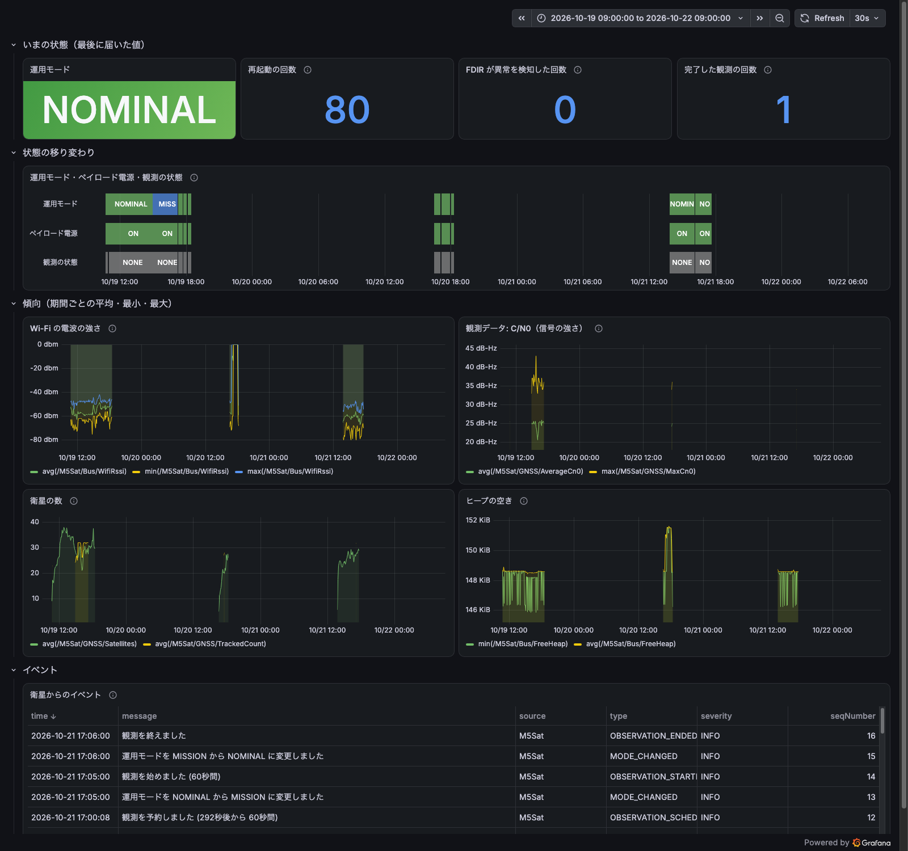

# m5stack-yamcs

M5StackとGNSSユニットを使って、YAMCSによる衛星テレメトリの仕組みを学ぶための実験プロジェクトです。

実際のGNSS衛星から受信したデータをM5Stackで取得し、最終的にYAMCSへTelemetryとして送信・可視化することを目標にしています。

> **初めて見る人へ**：M5Stack を人工衛星「M5Sat」、Mac の YAMCS を管制局に見立てて、衛星の運用を模擬しています。どれが衛星バス・ペイロード・地上局・管制局にあたるかと、データの流れは [docs/overview.md](docs/overview.md) にまとめています。30分のデモの進め方は [docs/demo.md](docs/demo.md) です。このREADMEは、Milestoneごとに作ってきた経緯と仕様の記録です。

## Goal

最終的には以下の構成を目指します。

```text
GNSS Satellites
      ↓ RF
Unit GPS SMA
      ↓ UART
M5Stack Core ESP32
      ↓ Wi-Fi / UDP
Mac
      ↓
YAMCS
      ↓
Telemetry / Archive / Monitor
```

将来的にはYAMCSからM5StackへのTelecommand（TC）も試し、簡単なMission Control Systemを構築します。

## Hardware

- M5Stack Core ESP32
- Unit GPS SMA
- Mac

## Development Environment

- VS Code
- PlatformIO
- Arduino Framework

## Documents

| ドキュメント | 内容 |
| --- | --- |
| [docs/overview.md](docs/overview.md) | システムの全体像。衛星バス・ペイロード・地上局・管制局が何にあたるか、データの流れ、ファイルの地図 |
| [docs/demo.md](docs/demo.md) | 30分のデモのシナリオ。準備、時間配分、見せるもの・話すこと、うまくいかないとき |
| [docs/scenarios.md](docs/scenarios.md) | 運用シナリオ集。YAMCS から衛星 M5Sat を運用するときの手順 |
| [docs/real-operations.md](docs/real-operations.md) | 本物の衛星運用との対応。FDIR、承認と役割分担、観測の計画、機上時刻、地上局とパスなど |
| [docs/yamcs-web-ui.md](docs/yamcs-web-ui.md) | YAMCS の Web UI の各メニューの役割 |

## Progress

### Milestone 1 - GNSS Reception ✅

Unit GPS SMAをM5StackのGroveポートへ接続し、UART経由でNMEAデータを受信できることを確認しました。

確認できたNMEAメッセージの例：

```text
$GNGGA
$GNRMC
$GNGSA
$GPGSV
$GLGSV
$GAGSV
$BDGSV
$GQGSV
```

GPS / GLONASS / Galileo / BeiDou / QZSSなど、複数のGNSS衛星群からの情報を確認しています。

### Milestone 2 - Telemetry Extraction ✅

NMEAデータから以下の情報を抽出します。

- Time
- Latitude
- Longitude
- Altitude
- Satellite count
- Fix status


外部ライブラリは使わず、NMEAパーサを [lib/NmeaParser](lib/NmeaParser/src/NmeaParser.h) に自作しています。チェックサムを検証したうえで、以下のセンテンスから値を取り出します（Talker ID は `GN` / `GP` などを問いません）。

| Sentence | 抽出する項目 |
| --- | --- |
| GGA | Time, Latitude, Longitude, Altitude, Satellite count, Fix quality |
| RMC | Date, Status (A/V) |
| GSA | Fix type (No fix / 2D / 3D) |
| GSV | 衛星ごとの番号・仰角・方位角・信号強度 (C/N0) |

M5Stackの画面は1秒ごとに更新し、ボタンでページを切り替えます。画面表示には [M5Unified](https://github.com/m5stack/M5Unified) を使っています。

| ボタン | 画面 | 内容 |
| --- | --- | --- |
| A（左） | INFO | 日付・時刻・緯度経度・高度・衛星数 |
| B（中） | SATS | 衛星システム別の内訳と、衛星ごとの信号強度 |
| C（右） | SYS | 衛星システムごとの名前・運用国と、見えている衛星番号の一覧 |
| C（右）を2秒長押し | - | 地上局との回線を Wi-Fi（UDP）⇔ ESP-NOW で切り替えて再起動する（ESP-NOW の節を参照） |

右上のバッジはFix statusを表し、`3D FIX`（緑）、`2D FIX`（黄）、`NO FIX`（赤）、`NO DATA`（灰：3秒以上NMEAを受信できていない）のいずれかになります。

SATS画面の見方：

- 上段のタイルは衛星システム別に「信号を捕捉している数 / 見えている数」を表示します（GPS・GLONASS・Galileo・BeiDou・QZSS）。
- 下段のバーは衛星ごとの信号強度（C/N0、dB-Hz）です。強い順に最大22機まで表示し、点線は良好な信号の目安（40 dB-Hz）です。
- 衛星番号の頭文字はRINEX形式の略号です（G=GPS、R=GLONASS、E=Galileo、C=BeiDou、J=QZSS）。

SYS画面では、GPS（アメリカ）・GLONASS（ロシア）・Galileo（欧州）・BeiDou（中国）・QZSS みちびき（日本）ごとに衛星番号を並べます。信号を捕捉している衛星はシステムの色で、見えているが捕捉していない衛星は灰色で表示します。

> M5Stack Core（Basic）のGrove Port A（GPIO21/22）は内部I2Cと同じピンです。そのため起動時に内部I2Cを解放し、そのピンをGPSのUARTに割り当てています。

同じ内容をシリアルへも出力します。

```text
[TLM] 2026-10-05T02:13:45.000Z lat=33.590355 lon=130.401716 alt=12.3m sats=12 fix=GPS(1) type=3D rmc=A ok=1520 err=0
```

受信したNMEAをそのまま見たい場合は [src/main.cpp](src/main.cpp) の `ECHO_RAW_NMEA` を `1` にします。

パーサはArduinoに依存しないため、Mac上でユニットテストを実行できます。

```sh
pio test -e native
```

### Milestone 3 - UDP Telemetry ✅

M5StackからWi-Fi経由でMacへTelemetryをUDP送信します。

Milestone 4でYAMCSへそのまま取り込めるよう、パケットは実際の衛星でも使われる **CCSDS Space Packet** の形式にしています。1秒に1回、48バイトのパケットを送ります。

#### セットアップ

1. Wi-Fiと送信先の設定ファイルを作ります。`include/secrets.h` は `.gitignore` に入っているので、コミットされません。

   ```sh
   cp include/secrets.example.h include/secrets.h
   ```

2. `include/secrets.h` にWi-FiのSSIDとパスワード、送信先のMacのIPアドレスを書きます。MacのIPアドレスは `ipconfig getifaddr en0` で確認できます。ESP32は2.4GHz帯のWi-Fiにしか接続できません。

3. Macで受信スクリプトを起動します（Python標準ライブラリのみで動きます）。初回はmacOSのファイアウォールが受信を許可するか尋ねてきます。

   ```sh
   python3 tools/udp_receiver.py
   ```

   ```text
   [192.168.1.23] apid=100 seq=   42 2026-10-05T02:13:45.000Z lat=33.590355 lon=130.401716 alt=12.3m sats=12 fix=GPS(1) type=3D rmc=A uptime=43.0s ok=1520 err=0
   ```

   YAMCSと一緒に動かす場合は、Milestone 4の `scripts/start.sh` を使ってください。受信スクリプトも一緒に起動されます。

M5StackのINFO画面の下部にWi-Fiの接続状態と送信したパケット数（`tx=`）が表示されます。

#### パケット形式

数値はすべてビッグエンディアンです。詳しくは [lib/TelemetryPacket](lib/TelemetryPacket/src/TelemetryPacket.h) を参照してください。

| Offset | Size | 型 | 内容 |
| --- | --- | --- | --- |
| 0 | 6 | - | CCSDS Primary Header（TM、APID=100、Sequence count） |
| 6 | 4 | uint32 | UTC時刻（Unix秒。無効なら0） |
| 10 | 2 | uint16 | UTCミリ秒 |
| 12 | 8 | float64 | 緯度（度） |
| 20 | 8 | float64 | 経度（度） |
| 28 | 4 | float32 | 海抜高度（m） |
| 32 | 1 | uint8 | 測位に使用している衛星数 |
| 33 | 1 | uint8 | Fix quality（GGA） |
| 34 | 1 | uint8 | Fix type（1=No fix, 2=2D, 3=3D） |
| 35 | 1 | uint8 | Flags（bit0:時刻有効, bit1:日付有効, bit2:位置有効, bit3:高度有効, bit4:RMC Active） |
| 36 | 4 | uint32 | 起動からの経過時間（ms） |
| 40 | 4 | uint32 | 正常に受信したNMEAセンテンス数 |
| 44 | 4 | uint32 | チェックサムエラー数 |

Sequence countは送信のたびに1増えます（14bitで一周）。受信スクリプトはこの番号の飛びからパケットロスを検出します。

#### ESP-NOW で地上局の無線機とつなぐ

Wi-Fiのアクセスポイントを使える場所ばかりではありません。5GHz専用だったり、つないだ機器どうしの通信が禁止されていたり（クライアント分離）すると、UDPではMacに届きません。そこで、もう1台のESP32（M5StickC）を**地上局の無線機**にして、ESP-NOWで衛星と直接やり取りする回線も用意しています。

```text
衛星 (M5Stack)  ~~~ ESP-NOW (2.4GHz) ~~~  地上局の無線機 (M5StickC)  ──USB──  Mac (受信スクリプト → YAMCS)
```

- 衛星はTMをブロードキャストで送ります。地上局の無線機は、TMを送ってきた衛星を覚え、その衛星へTCを送ります
- 地上局の無線機とMacの間は、USBシリアルでパケットをやり取りします。パケットの区切りには、CCSDSの通信と同じ同期用の印（ASM `1A CF FC 1D`）と、CRC-16を使います（[lib/SerialFrame](lib/SerialFrame/src/SerialFrame.h)）
- 地上局の無線機の画面には、衛星からの電波が届いているか（AOS / LOS）、TMとTCの数、衛星のMACアドレスが出ます

1. 地上局の無線機（M5StickC）にファームウェアを書き込みます。`platformio.ini` の `ground-station` の `upload_port` を、M5StickCのポートにしてください

   ```sh
   pio run -e ground-station -t upload
   ```

2. 衛星（M5Stack）の**右のボタン（C）を2秒長押し**すると、Wi-Fi（UDP）⇔ ESP-NOW が切り替わります。選んだ回線はM5Stackのフラッシュ（NVS）に保存され、M5Stackは再起動します。再起動すると `BOOT` のイベント（理由: SOFTWARE）が届くので、地上でも切り替わったことがわかります。今どちらの回線かは、INFO画面の一番下の行に出ます

   まだ一度も切り替えていないときは、`include/secrets.h` の指定に従います

   ```c
   #define GROUND_LINK_ESPNOW 1   // 0: Wi-Fi (UDP), 1: ESP-NOW
   #define ESPNOW_CHANNEL 1
   ```

3. プロジェクト直下の `.env` に、M5StickCのポートを書きます（`.env` はコミットされません）

   ```sh
   GROUND_STATION_SERIAL=/dev/cu.usbserial-XXXX
   ```

4. `scripts/start.sh` で起動すると、受信スクリプトがUDPに加えてシリアルからも受け取ります。M5StickCのUSBを抜き差ししても、受信スクリプトが自動でつなぎ直します

コマンドは、Web UIのほか `python3 tools/send_command.py BEEP Duration=300` のようにターミナルからも送れます。

### Milestone 4 - YAMCS ✅

UDPで受信したTelemetryをYAMCSへ取り込み、Mission Databaseでパラメータとして定義します。

```text
M5Stack ──UDP:10015──▶ tools/udp_receiver.py ──UDP:10016──▶ YAMCS ──▶ Web UI (http://localhost:8090)
                        (受信ログ logs/udp_receiver.log)
```

YAMCSとMilestone 3の受信スクリプトは同じポートを同時に使えません。そのため受信スクリプトが10015番で受けてログを取り、同じパケットをYAMCS（10016番）へ中継します。M5Stack側の設定は変えなくて構いません。

#### セットアップ

YAMCSはJavaで動きます。初回だけJava 17をインストールしてください。

```sh
brew install openjdk@17
```

#### 起動と終了

```sh
scripts/start.sh    # YAMCS と受信スクリプトをバックグラウンドで起動
scripts/status.sh   # 動いているかと、YAMCSが受信したパケット数を表示
scripts/stop.sh     # 両方を終了
```

初回の起動は、YAMCSの依存ライブラリをダウンロードするため数分かかります。ログは `logs/` に出力されます。

起動したら http://localhost:8090 を開き、インスタンス `gnss` を選びます。Telemetry → Parameters で `/M5Sat/GNSS/Latitude` などの値を見られます。パラメータを開くとグラフも表示されます。

#### YAMCSの構成

| ファイル | 内容 |
| --- | --- |
| [yamcs/src/main/yamcs/mdb/m5sat.xml](yamcs/src/main/yamcs/mdb/m5sat.xml) | Mission Database（XTCE）。パケットのどこに何が入っているかを定義する。`/M5Sat/Bus`（バス）と `/M5Sat/GNSS`（ペイロード）に分かれる |
| [yamcs/src/main/yamcs/etc/yamcs.gnss.yaml](yamcs/src/main/yamcs/etc/yamcs.gnss.yaml) | インスタンス `gnss` の設定。TMのデータリンク（10016番で受信）、TCのデータリンク（10025番へ送信）、パケットの前処理と後処理 |
| [yamcs/pom.xml](yamcs/pom.xml) | YAMCSのバージョン（公式 [quickstart](https://github.com/yamcs/quickstart) がベース） |

パラメータは Milestone 3 のパケット形式と1対1で対応しています（`/M5Sat/GNSS/UtcTime`、`/M5Sat/GNSS/Latitude`、`/M5Sat/GNSS/Satellites` など）。次のアラームを定義しています。

| パラメータ | 条件 | レベル |
| --- | --- | --- |
| `/M5Sat/GNSS/Satellites` | 4機未満（3D測位できない） | Warning |
| `/M5Sat/GNSS/FixType` | `NoFix` | Warning |

受信時刻にはYAMCSが受け取った時刻を使います。GNSSから得たUTC時刻は、パラメータ `/M5Sat/GNSS/UtcTime` として見られます。保存したテレメトリは `yamcs/target/yamcs/yamcs-data` に入ります。`mvn clean` で消えます。

### Milestone 5 - Satellite Operations Simulation ✅

M5Stackを1機の衛星に見立てて、YAMCSを地上局として運用する模擬実験をします。テレメトリを受けるだけでなく、地上からコマンドを送り、衛星が実行したことを確かめるところまでを体験します。

```text
            ┌─────────── 衛星 (M5Stack) ───────────┐
            │  バス:      モード管理・HK・コマンド処理  │
            │  ペイロード: GNSS受信機 (観測機器)         │
            └──────────────────────────────────────┘
               ▲ TC (UDP)                  │ TM (UDP)
               │                           ▼
            ┌─────────── 地上局 (Mac) ──────────────┐
            │  YAMCS: コマンド送信・実行確認・Timeline  │
            └──────────────────────────────────────┘
```

衛星は、バス（衛星を動かすための共通部分）とペイロード（ミッションの観測機器）に分けて考えます。このプロジェクトでは、GNSS受信機をペイロードとして扱います。YAMCSのメニューごとの役割は [docs/yamcs-web-ui.md](docs/yamcs-web-ui.md) にまとめています。

#### 想定ミッション

> **M5Sat** は、地上に届くGNSS衛星の電波の強さを観測する衛星です。運用チームは、計画した時間帯にペイロードで観測を行い、観測データを地上で回収します。衛星に異常があれば、衛星は自分で安全なモードへ退避し、運用チームが原因を調べて復旧させます。

各ステップには、このミッションに沿った**運用シナリオ**があります。シナリオをYAMCS上で実際に操作して最後まで進められたら、そのステップは完了です。手順は [docs/scenarios.md](docs/scenarios.md) にまとめていて、作りながら育てていきます。ここでは各ステップの仕様を書きます。

#### 進め方

1ステップを1つのPRにします。後のステップは前のステップの機能を使うので、上から順に進めます。

| Step | 内容 | 主に使うYAMCSの機能 |
| --- | --- | --- |
| 5-1 | Housekeeping テレメトリ | Telemetry |
| 5-2 | Telecommand と Command Verification | Commanding |
| 5-3 | 衛星からのイベント通知 | Events |
| 5-4 | 運用モードと異常時の自動退避（FDIR） | Alarms, Events |
| 5-5 | コマンドの安全装置 | Mission database, Commanding（Queues） |
| 5-6 | ペイロード運用と観測データ | Telemetry, Commanding |
| 5-7 | 運用手順（コマンドスタック） | Procedures（Stacks） |
| 5-8 | 運用画面 | Displays（OPI、Parameter Table） |
| 5-9 | Timeline とパス運用 | Timeline, Links, Archive browser |
| 5-10 | 異常対応の訓練 | Alarms, Events, Command history |

#### 5-1 Housekeeping テレメトリ ✅

衛星の健康状態を表すHK（Housekeeping）テレメトリを、GNSSテレメトリとは別のAPID（101）で、1秒ごとに送ります。YAMCSでは `/M5Sat/Bus/` の下にパラメータとして並びます。

| Offset | Size | 型 | パラメータ | 内容 |
| --- | --- | --- | --- | --- |
| 0 | 6 | - | - | CCSDS Primary Header（TM、APID=101、Sequence countはAPIDごと） |
| 6 | 1 | uint8 | `Mode` | 運用モード（0=SAFE, 1=NOMINAL, 2=MISSION） |
| 7 | 1 | uint8 | `PayloadPower` | ペイロードの電源（0=OFF, 1=ON） |
| 8 | 2 | uint16 | `AcceptedCommands` | 受理したコマンド数 |
| 10 | 2 | uint16 | `RejectedCommands` | 拒否したコマンド数 |
| 12 | 1 | uint8 | `LastCommandId` | 最後に実行したコマンドのID（0=なし） |
| 13 | 1 | int8 | `WifiRssi` | Wi-Fiの電波の強さ（dBm） |
| 14 | 4 | uint32 | `FreeHeap` | ヒープの空き容量（bytes） |
| 18 | 4 | uint32 | `MinFreeHeap` | 起動してからのヒープの空き容量の最小値（bytes） |
| 22 | 4 | uint32 | `Uptime` | 起動からの経過時間（ms） |
| 26 | 2 | uint16 | `BootCount` | 再起動の回数。電源を切っても消えないよう、M5Stackのフラッシュ（NVS）に保存する |
| 28 | 1 | uint8 | `ResetReason` | 前回の再起動の理由（ESP-IDF の `esp_reset_reason_t`） |

詳しくは [lib/TelemetryPacket/src/HousekeepingPacket.h](lib/TelemetryPacket/src/HousekeepingPacket.h) を参照してください。

- 運用モードとペイロードの電源は、切り替えを実装する 5-2 / 5-4 までは NOMINAL・ON 固定です。コマンドカウンタも 5-2 までは 0 のままです。
- リセットボタンによる再起動は、ESP32の仕様で `POWER_ON` として記録されます。
- 電池残量はGrove Port Aと内部I2Cのピンが共用のため読めません（Milestone 2参照）。

**運用シナリオ**：[docs/scenarios.md](docs/scenarios.md#s5-1) を見てください。

#### 5-2 Telecommand と Command Verification ✅

YAMCSからM5StackへCCSDSのTCパケットをUDPで送ります。コマンドはMission Databaseに定義し、Web UIの Commanding → Send a command から送信します。

```text
YAMCS ──TC──▶ :10025 tools/udp_receiver.py ──TC──▶ M5Stack :10025
  ▲                  (地上局の中継)                        │
  └──── :10016 ◀── :10015 ◀────────── TM (HK / ACK / GNSS) ┘
```

受信スクリプトは地上局として、TCの中継も受け持ちます。TCは、直近にTMを送ってきたM5StackのIPアドレスへ送ります。TMが届いていない（衛星が見えていない）間は、TCは送れません。本物の地上局と同じです。

| ID | コマンド | 引数 | 内容 |
| --- | --- | --- | --- |
| 1 | `NO_OP` | なし | 何もしない。通信路の確認用 |
| 2 | `SET_MODE` | `Mode`（SAFE / NOMINAL / MISSION） | 運用モードを切り替える。SAFEにするとペイロードもOFFになる。ペイロードがOFFのときはMISSIONにできない |
| 3 | `SET_TM_INTERVAL` | `Interval`（ms） | テレメトリの送信周期を変える。200〜10000ms 以外は拒否する |
| 4 | `PAYLOAD_POWER` | `State`（ON / OFF） | ペイロードの電源をON / OFFする。OFFの間はGNSSテレメトリを送らない。MISSION中にOFFにするとNOMINALに戻る |
| 5 | `RESET_COUNTERS` | なし | コマンドカウンタをリセットする |
| 6 | `BEEP` | `Duration`（ms） | スピーカーを鳴らす。50〜2000ms 以外は拒否する。鳴り終わってから実行完了になる |

範囲のチェックは衛星側でも行っています。5-5からは地上（YAMCS）でも同じ範囲を検査するので、範囲外の値はYAMCSが送る前に止めます。

TCパケット（APID 110）は、CCSDS Primary Header の後ろにコマンドID（1バイト）と引数（ビッグエンディアン）が続きます。長さフィールドとシーケンス番号は、YAMCSの `IssCommandPostprocessor` が埋めます。

##### コマンドの応答（ACK、APID 102）

衛星はTCを受けると、ACKパケットを返します。

| Offset | Size | 型 | パラメータ | 内容 |
| --- | --- | --- | --- | --- |
| 0 | 6 | - | - | CCSDS Primary Header（TM、APID=102） |
| 6 | 2 | uint16 | `AckTcSequence` | どのTCへの応答か（TCのシーケンス番号） |
| 8 | 1 | uint8 | `AckCommandId` | コマンド |
| 9 | 1 | uint8 | `AckStage` | 1=ACCEPTED（受理）, 2=REJECTED（拒否）, 3=COMPLETED（実行完了）, 4=FAILED（実行失敗） |
| 10 | 1 | uint8 | `AckErrorCode` | 0=なし, 1=知らないコマンド, 2=引数の長さが違う, 3=引数が範囲外, 4=今の状態では実行できない, 5=TCパケットとして不正 |

YAMCSのMission Databaseでは、ACKのシーケンス番号と、コマンド履歴に残ったTCのシーケンス番号（`/yamcs/cmdHist/ccsds-seqcount`）を照らし合わせるVerifierを定義しています。

| Verifier | 条件 | 待つ時間 |
| --- | --- | --- |
| Accepted | ACKの段階が ACCEPTED | 5秒 |
| Complete | ACKの段階が COMPLETED | 10秒 |
| Failed | ACKの段階が REJECTED か FAILED | 10秒 |

Commanding → Command history を開くと、コマンドごとに Accepted → Complete と進む様子、または Failed になった様子を確認できます。拒否の理由は `/M5Sat/Bus/AckErrorCode` で見られます。

**運用シナリオ**：[docs/scenarios.md](docs/scenarios.md#s5-2) を見てください。

##### ペイロード電源のLED

M5StackのG26にLEDをつなぐと、ペイロードの電源がONのあいだLEDが点きます。地上から `PAYLOAD_POWER` を送ると実際にLEDが点いたり消えたりするので、コマンドの結果を目で確かめられます。

```text
M5Stack G26 ──[抵抗 220〜330Ω]──▶|── GND
                                LED（足の長い方 = アノードを G26 側へ）
```

- G26 は、起動時の動作に関わるピン（ストラッピングピン）ではないので、LEDをつないでも起動に影響しません
- G25 はスピーカーが使っています。G16 / G17 は、将来GPSを Port C へ移すときのために空けています
- 抵抗は必ず入れてください

`SET_MODE SAFE` でペイロードの電源が切れたときも、LEDは消えます。

#### 5-3 衛星からのイベント通知 ✅

衛星が「モードが変わった」「コマンドを拒否した」などの出来事を、イベント用のパケット（APID 103）で地上に知らせます。YAMCSでは **Events** に文章で並ぶので、何が起きたかを時系列で追えます。

本物の衛星と同じく、衛星は**イベントの番号と数値だけ**を送り、文章は地上で組み立てます。衛星側のメモリと通信量を節約でき、文章を直したいときも地上側（Mission Database）だけで済みます。

```text
衛星:  EVENT(WARNING, COMMAND_REJECTED, arg1=3, arg2=3)
  ↓
YAMCS: WARNING  M5Sat  COMMAND_REJECTED  コマンド SET_TM_INTERVAL を拒否しました: 引数が範囲外です
```

| ID | イベント | 重要度 | 引数1 / 引数2 | Events に出る文章 |
| --- | --- | --- | --- | --- |
| 1 | `BOOT` | INFO | 再起動の回数 / 再起動の理由 | 起動しました (14回目, 理由: POWER_ON) |
| 2 | `MODE_CHANGED` | INFO | 変更前 / 変更後のモード | 運用モードを NOMINAL から SAFE に変更しました |
| 3 | `PAYLOAD_POWER_CHANGED` | INFO | 0=OFF, 1=ON | ペイロードの電源を OFF にしました |
| 4 | `TM_INTERVAL_CHANGED` | INFO | 周期（ms） | テレメトリの送信周期を 2000ms に変更しました |
| 5 | `COUNTERS_RESET` | INFO | - | コマンドカウンタをリセットしました |
| 6 | `COMMAND_REJECTED` | WARNING | コマンドID / エラーコード | コマンド SET_TM_INTERVAL を拒否しました: 引数が範囲外です |

- 状態が実際に変わったときだけ出します。たとえば、NOMINALのときに `SET_MODE NOMINAL` を送ってもイベントは出ません。
- Wi-Fiにつながる前に起きたイベント（起動時の `BOOT` など）は、衛星側に溜めておき、つながってから送ります（最大16個。あふれたら古いものから捨てます）。

| Offset | Size | 型 | パラメータ | 内容 |
| --- | --- | --- | --- | --- |
| 0 | 6 | - | - | CCSDS Primary Header（TM、APID=103） |
| 6 | 1 | uint8 | `EventSeverity` | 0=INFO, 1=WATCH, 2=WARNING, 3=DISTRESS, 4=CRITICAL, 5=SEVERE |
| 7 | 1 | uint8 | `EventId` | 上の表のID |
| 8 | 2 | uint16 | `EventArg1` | 引数1 |
| 10 | 2 | uint16 | `EventArg2` | 引数2 |

文章を組み立てているのは、Mission Database の `/M5Sat/Bus/SatelliteEventMessage` というアルゴリズム（JavaScript）です。イベントパケットが届くたびに動き、YAMCSの `EventLog` でイベントを出します。過去データの再生で同じイベントが重複しないよう、リアルタイムのプロセッサのときだけ出します。

**運用シナリオ**：[docs/scenarios.md](docs/scenarios.md#s5-3) を見てください。

#### 5-4 運用モードと異常時の自動退避（FDIR） ✅

衛星側で運用モードを管理します。

| モード | 状態 |
| --- | --- |
| SAFE | 最低限の機能だけ動かす。ペイロードはOFF |
| NOMINAL | 通常運用。HKとGNSSテレメトリを送る |
| MISSION | ペイロードで観測し、観測データを送る |

異常を検知したら、衛星が自分でSAFEモードへ移ります（FDIR: Fault Detection, Isolation and Recovery）。

| 段階 | 衛星がすること |
| --- | --- |
| 検知（Detection） | ペイロードの電源がONなのに、GNSSのデータが **10秒** 届かない → ペイロードの異常とみなす |
| 分離（Isolation） | ペイロードの電源を切る（LEDも消える） |
| 退避（Recovery） | 運用モードを SAFE にする。`FAULT_DETECTED` のイベント（DISTRESS）で地上へ知らせる |

- ペイロードの電源を入れてから**最初のデータが届くまでは30秒**、GPSユニットが動き出すのを待ちます。一度データが届いたあとは、10秒届かなければ異常とみなします。電源を入れる前に届いていた古いデータは数えません
- SAFEのままでも、ペイロードの電源を入れればまた監視します。原因が直っていなければ、もう一度ペイロードを切ります
- **復旧は地上からのコマンドで行います**。衛星は自分では NOMINAL に戻りません

FDIRは、地上からのコマンドで有効・無効にできます（起動時は有効）。試験のときや、5-10の異常対応の訓練で使います。

| ID | コマンド | 引数 | 内容 |
| --- | --- | --- | --- |
| 7 | `SET_FDIR` | `State`（ON / OFF） | FDIRを有効・無効にする。`FDIR_CHANGED` のイベントが届く |

HKには、FDIRの状態を表す項目を追加しました（HKのパケットは33バイトになりました）。

| Offset | Size | 型 | パラメータ | 内容 |
| --- | --- | --- | --- | --- |
| 29 | 1 | uint8 | `FdirEnabled` | FDIRが有効か（0=OFF, 1=ON） |
| 30 | 1 | uint8 | `LastFault` | 最後に検知した異常（0=NONE, 1=GNSS_NO_DATA） |
| 31 | 2 | uint16 | `FaultCount` | これまでに検知した異常の回数 |

YAMCSでは、`/M5Sat/Bus/Mode` が SAFE になると **Warning のアラーム**が上がります。

復旧は地上からのコマンドで行います（`SET_MODE NOMINAL` → `PAYLOAD_POWER ON`）。手順は [docs/scenarios.md](docs/scenarios.md#s5-4) にあります。FDIRを宇宙機で重視する理由は [docs/real-operations.md](docs/real-operations.md#fdir) にまとめています。

**運用シナリオ**：[docs/scenarios.md](docs/scenarios.md#s5-4) を見てください。

#### 5-5 コマンドの安全装置 ✅

誤ったコマンドで衛星を危険にさらさないための仕組みを、地上（YAMCS）に入れました。衛星側のルール（何が届いても自分を守る、最後の砦）に、地上側のルール（そもそも危ないコマンドを送らない）を重ねた二重の守りです。衛星のファームウェアは変えず、Mission Database と設定だけで実現しています。

**1. 引数の範囲**

| コマンド | 引数 | 範囲 |
| --- | --- | --- |
| `SET_TM_INTERVAL` | `Interval` | 200〜10000 ms |
| `BEEP` | `Duration` | 50〜2000 ms |

範囲外の値は、YAMCSが送る前に断ります（衛星には届きません）。衛星側も同じ範囲で検査しています。

**2. 送信の前提条件（Transmission Constraint）**

衛星の今の状態（テレメトリ）とコマンドの引数を見て、送ってよいかを判断します。条件を満たさないと、YAMCSは「Transmission constraints check failed」で止めます。

| コマンド | 送ってよい条件 | 理由 |
| --- | --- | --- |
| `PAYLOAD_POWER` | `/M5Sat/Bus/Mode` が SAFE でない | SAFEは異常からの退避中なので、ペイロードを操作しない |
| `SET_MODE` | MISSION にするときは `/M5Sat/Bus/PayloadPower` が ON | ペイロードが動いていないと観測できない（引数は `/yamcs/cmd/arg/Mode` で参照する） |

YAMCSが判断に使うのは、届いている最新のテレメトリです。コマンドの結果がHKに反映されるまで最大1秒かかるので、**前のコマンドの結果をテレメトリで確かめてから**次のコマンドを送ります。

**3. 重要度（Significance）と承認フロー（Queues）**

| コマンド | 重要度 | 送り方 |
| --- | --- | --- |
| `SET_MODE` / `SET_FDIR` | critical | 承認用の待ち行列 `supervised` に入る。運用者が Commanding → Queues で承認（Accept）すると送られる |
| `PAYLOAD_POWER` / `RESET_COUNTERS` | vital | すぐ送られる。Web UIでは重要なコマンドとして表示される |
| その他 | normal | すぐ送られる |

待ち行列は [yamcs/src/main/yamcs/etc/command-queue.yaml](yamcs/src/main/yamcs/etc/command-queue.yaml) で定義しています。ターミナルから試験するときは、`python3 tools/send_command.py SET_MODE Mode=NOMINAL --approve` のように `--approve` を付けると、待ち行列で自動で承認します（普段の運用では人が承認します）。

待ち行列での承認が、本物の運用で誰と誰のやり取りにあたるか（管制局・ペイロード運用チーム・地上局の役割）は、[docs/real-operations.md](docs/real-operations.md#roles) にまとめています。

**運用シナリオ**：[docs/scenarios.md](docs/scenarios.md#s5-5) を見てください。

#### 5-6 ペイロード運用と観測データ ✅

ペイロード（GNSS受信機）で「観測」を行い、観測データを地上へ送ります。観測は時刻指定で予約でき、衛星は予約した時刻に自分でMISSIONへ移って観測を始め、自分で終えます。地上と通信できない間も、計画どおりに動きます。

##### 観測データ（APID 104）

MISSIONモードで、ペイロードの電源がONのときだけ、テレメトリの周期で送ります。YAMCSでは `/M5Sat/GNSS/` の下に並びます。

| Offset | Size | 型 | パラメータ | 内容 |
| --- | --- | --- | --- | --- |
| 0 | 6 | - | - | CCSDS Primary Header（TM、APID=104） |
| 6 | 4 | uint32 | `ObservationTime` | 観測した時刻（Unix秒） |
| 10 | 1 | uint8 | `ObservedCount` | 見えている衛星の数（下の一覧の数、最大32） |
| 11 | 1 | uint8 | `TrackedCount` | 信号を捕捉している衛星の数 |
| 12 | 1 | uint8 | `MaxCn0` | C/N0の最大（dB-Hz） |
| 13 | 1 | uint8 | `AverageCn0` | 捕捉している衛星のC/N0の平均（dB-Hz） |
| 14 | 5 | uint8 | `TrackedGps` / `TrackedGlonass` / `TrackedGalileo` / `TrackedBeidou` / `TrackedQzss` | システム別の捕捉数 |
| 19 | 6×N | - | `ObservedSatellites` | 衛星ごとの一覧（C/N0の強い順）。1機ごとに システム・衛星番号・仰角・方位角・C/N0 |

- まとめの値（`TrackedCount`、`AverageCn0` など）は、YAMCSでそのままグラフにできます
- 衛星ごとの一覧は、Mission Database で「構造体の配列」（`ArrayParameterType` と `AggregateParameterType`）として定義しています。配列の長さは、パケットの中の `ObservedCount` で決まります

##### 機上時刻

予約した時刻を判断するため、衛星は今の時刻（機上時刻）を持っています（[OnboardClock.h](lib/Satellite/src/OnboardClock.h)）。

- GPSの時刻が届くたびに合わせ、その間は衛星の中の時計で数え続けます。ペイロードを切っても、時刻はわかります
- まだ一度もGPSの時刻を受け取っていなければ「不明」です。このときは時刻指定のコマンドを受け付けません
- HKの `/M5Sat/Bus/OnboardTime` で見られます

##### 時刻指定の観測予約

| ID | コマンド | 引数 | 内容 |
| --- | --- | --- | --- |
| 8 | `SCHEDULE_OBSERVATION` | `Start`（UTCの時刻）、`Duration`（10〜3600秒） | 観測を予約する。予約は1つだけで、新しく予約すると前の予約は置き換わる |
| 9 | `CANCEL_OBSERVATION` | なし | 予約、または観測中の観測を取り消す（観測中ならNOMINALに戻る） |

どちらも衛星のモードを変えるので、重要度は critical です（Commanding → Queues で承認してから送ります）。`Start` は、Web UIでは時刻として入力できます。

| 予約した時刻に | 衛星がすること | イベント |
| --- | --- | --- |
| NOMINALで、ペイロードがON | MISSIONへ移って観測を始める | `OBSERVATION_STARTED` |
| ペイロードがOFF、またはNOMINALでない | 観測を見送る | `OBSERVATION_SKIPPED`（WARNING） |
| 長さが過ぎた | NOMINALへ戻る | `OBSERVATION_ENDED`（完了） |
| 観測中にMISSIONでなくなった（FDIRの退避など） | 観測を中断する | `OBSERVATION_ENDED`（中断、WARNING） |

機上時刻が不明なとき、開始時刻が過去のとき、観測中に予約し直そうとしたときは、衛星がコマンドを拒否します。

HKには、観測の状態を表す項目を追加しました（HKのパケットは44バイトになりました）。

| Offset | Size | 型 | パラメータ | 内容 |
| --- | --- | --- | --- | --- |
| 33 | 4 | uint32 | `OnboardTime` | 機上時刻（Unix秒、不明なら0） |
| 37 | 1 | uint8 | `ObservationState` | 0=NONE, 1=SCHEDULED（予約中）, 2=ACTIVE（観測中） |
| 38 | 4 | uint32 | `ObservationStart` | 予約した開始時刻 |
| 42 | 2 | uint16 | `ObservationDuration` | 予約した長さ（秒） |

本物の衛星で観測をどう計画・運用しているかは、[docs/real-operations.md](docs/real-operations.md#planning) にまとめています。

**運用シナリオ**：[docs/scenarios.md](docs/scenarios.md#s5-6) を見てください。

#### 5-7 運用手順（コマンドスタック） ✅

決まった作業の手順を、YAMCSのコマンドスタック（Procedures → Stacks）として用意しました。本物の運用での手順書の役割です。

| スタック | 手順 |
| --- | --- |
| `01-link-check.ycs`（通信の確認） | HKを確認 → `NO_OP` → 受理数と最後のコマンドを確認 |
| `02-observation-start.ycs`（観測開始） | 状態を確認 → `PAYLOAD_POWER ON` → ペイロードONを待つ → GNSSのデータを待つ → `SET_MODE MISSION`（承認） → MISSIONを待つ → 観測データを確認 |
| `03-observation-end.ycs`（観測終了） | 状態を確認 → `SET_MODE NOMINAL`（承認） → NOMINALを待つ → `PAYLOAD_POWER OFF` → OFFを待つ |
| `04-safe-recovery.ycs`（SAFEからの復旧） | 始める前の確認 → 状態と異常の種類を確認 → `SET_MODE NOMINAL`（承認） → NOMINALを待つ → `PAYLOAD_POWER ON` → GNSSのデータを待つ → 再び退避していないか確かめる |

スタックは `.ycs`（JSON）のファイルで、[yamcs/src/main/yamcs/stacks/](yamcs/src/main/yamcs/stacks/) に置いています。`yamcs.yaml` の `buckets` で、このフォルダをそのままYAMCSの `stacks` バケットにしているので、gitで管理でき、Web UIで編集した内容もこのファイルに残ります。

| ステップ | 使い方 |
| --- | --- |
| `text` | 手順の説明（Markdown） |
| `check` | パラメータの今の値を表示して、運用者に確かめさせる |
| `command` | コマンドを送る。すべて `advancement` を `CommandComplete` にしていて、Command Verificationが完了するまで次へ進まない。critical のコマンドは、Queuesで承認されるまでここで止まる |
| `verify` | テレメトリが条件を満たすまで待つ。時間切れになると、スタックはそこで止まる |

`verify` で「コマンドの結果がHKに出るのを待ってから次を送る」（5-5を参照）を手順に組み込んでいます。手順書を使う理由は [docs/real-operations.md](docs/real-operations.md#procedures) にまとめています。

**運用シナリオ**：[docs/scenarios.md](docs/scenarios.md#s5-7) を見てください。

#### 5-8 運用画面 ✅

運用者がパス中に1画面で衛星の状態をつかめるよう、YAMCSの **Telemetry → Displays** に運用画面を置きました。長い期間のトレンドを見るのは Grafana（#21）の役目で、こちらは「いまの状態」を見て次のコマンドを判断するための画面です。

| 画面 | 形式 | 中身 |
| --- | --- | --- |
| `m5sat-overview.opi` | OPI（CS-Studio / Yamcs Studio の画面形式） | 衛星の状態、コマンド、FDIR、観測、GNSS、位置、データレコーダの区画と、コマンドのボタン |
| `m5sat-hk.par` | Parameter Table | HKのパラメータの表。Web UIから項目を足し引きして保存できる |

画面のファイルは [yamcs/src/main/yamcs/displays/](yamcs/src/main/yamcs/displays/) に置き、5-7のスタックと同じく `yamcs.yaml` の `buckets` で `displays` バケットにしています。Parameter lists（Telemetry → Parameter lists）はYAMCSのデータベースに保存されてgitで管理できないので、同じ役目を Parameter Table（`.par`）で持たせています。

運用画面の工夫：

- 運用モードは背景の色（NOMINAL 緑 / MISSION 青 / SAFE 黄）で見分ける。OPIのルール（`pvStr0=="SAFE"` など）で色を変えている。期限切れは、周りの太い枠が紫になることで目立たせる
- ペイロード電源とFDIRは ON/OFF のランプにする
- 値の枠はアラームに合わせて色が変わる（警告はオレンジ、重大は赤。SAFE、測位できていない など）
- ボタン（`NO_OP`、`PAYLOAD_POWER`、`SET_MODE`、`SET_FDIR`）は確認ダイアログを出してから送る。`SET_MODE` はボタンから送っても5-5の待ち行列に入る

**テレメトリが途切れたことに気づく**：MDBの HK・GNSS・観測データのコンテナに、最低限届く頻度（`DefaultRateInStream`、10秒に1回）を書きました。届かなくなると、約19秒（10秒 × 1.9）で値が期限切れ（`EXPIRED`）になり、運用画面の値が紫になります。これがないと、衛星が止まっても最後の値が表示されたままで、通信が途切れたことに気づけません。

| 状況 | 期限切れになる値 |
| --- | --- |
| 衛星の電源が切れた・通信が途切れた | すべて |
| ペイロードをOFFにした | GNSSの値 |
| MISSIONを抜けた | 観測データの値 |

ACK（最後のACK・段階・理由）は、コマンドを送ったときだけ届くパケットなので、期限を付けていません。コマンドを送らなければ届かないのが正常だからです。

**運用シナリオ**：[docs/scenarios.md](docs/scenarios.md#s5-8) を見てください。

#### 5-9 Timeline とパス運用 ✅

衛星と通信できる時間（パス）が限られている状況を再現し、YAMCSの **Timeline** で運用を計画して進めます。

**パスの計画**：本物の運用では、衛星の軌道と地上局の場所からパスの時刻を予測します。M5Satは軌道を回っていないので、[tools/plan_passes.py](tools/plan_passes.py) で決まった間隔の人工のパスを作ります。

```sh
python3 tools/plan_passes.py create                 # 2分後から、10分ごとに2分間のパスを3回
python3 tools/plan_passes.py create --passes 5 --interval 6 --duration 2
python3 tools/plan_passes.py list                   # 計画と、アクティビティの実行状況
python3 tools/plan_passes.py clear                  # これからの予定を消し、常時通信に戻す (終わった予定は振り返り用に残す)
python3 tools/plan_passes.py clear --all            # 終わった予定も含めて全部消す
```

Timelineには次の予定を作ります。予定・帯・ビューはYAMCSのデータベースに保存されてgitで管理できないので、このスクリプトで作り直せるようにしています。

| 予定 | 種類 | 中身 |
| --- | --- | --- |
| パス | イベント | 通信できる時間帯 |
| AOS | アクティビティ（スクリプト） | パスの始めに、TM・TCのデータリンクを有効にする。テレメトリが実際に届き始めたら成功（15秒届かなければ失敗） |
| 通信の確認 | アクティビティ（スタック） | AOSが成功したら、5-7の `01-link-check.ycs` を自動で実行する |
| LOS | アクティビティ（スクリプト） | パスの終わりに、データリンクを無効にする。パスの外では衛星と通信できない |
| 観測の予定 | イベント | パスとパスの間の観測。パスの間に、運用者が `SCHEDULE_OBSERVATION` で予約する（説明欄に引数を書いてある） |

データリンクの切り替えは [yamcs/src/main/yamcs/etc/scripts/set_links.py](yamcs/src/main/yamcs/etc/scripts/set_links.py) で行い、`yamcs.gnss.yaml` でTimelineのサービスと、スクリプトのアクティビティ（`.py` を `python3` で動かす）を設定しています。

ビュー「パス運用」には、時刻の目盛（UTC と日本時間）、パス、通信と手順、観測の予定、送ったコマンド、運用モード・観測の状態・最後の観測の結果・ペイロード電源の移り変わりを並べます。パスの外は衛星の状態の帯が途切れるので、いつ通信できていたかが一目でわかります。

**最後の観測の結果をHKに残す**：観測はパスとパスの間（通信できない間）に行われるので、その間のイベントや観測データは地上に届きません。そこで、衛星が最後の観測の結果を覚えておき、HKで送り続けるようにしました（HKのパケットは53バイトになりました）。次のパスでHKを見れば、観測がどうなったかがわかります。

| Offset | Size | 型 | パラメータ | 内容 |
| --- | --- | --- | --- | --- |
| 44 | 1 | uint8 | `LastObservationResult` | 0=NONE, 1=COMPLETED（完了）, 2=ABORTED（中断）, 3=SKIPPED_PAYLOAD_OFF, 4=SKIPPED_NOT_NOMINAL（見送り）, 5=CANCELLED（取り消し） |
| 45 | 4 | uint32 | `LastObservationStart` | 実際に始めた時刻（見送り・開始前の取り消しは予約の時刻） |
| 49 | 2 | uint16 | `LastObservationLength` | 実際に観測した長さ（秒） |
| 51 | 2 | uint16 | `CompletedObservations` | 完了した観測の回数 |

中断・見送りのときは警告のアラームが上がるので、次のパスの始めに気づけます。値は衛星のRAMにあり、再起動すると消えます（再起動したことは、再起動の回数でわかります）。

通信できない間のイベントや観測データそのものを衛星の中に記録し、パスで降ろす（ダンプ）のは、[issue #34](https://github.com/vestige/m5stack-yamcs/issues/34) で扱います。

**運用シナリオ**：[docs/scenarios.md](docs/scenarios.md#s5-9) を見てください。

#### 5-10 異常対応の訓練 ✅

運用者が、衛星の異常に気づき、原因を推定し、手順書で元に戻すまでを訓練します。訓練の出題者は、運用者に知らせずに異常を1つ起こします。運用者はいつもの画面（運用画面、Alarms、Events、Command history）だけを頼りに対応し、あとで気づくまでと復旧までにかかった時間を振り返ります。

**異常を起こす操作は、運用者から見えないようにする**：出題者は [tools/inject_fault.py](tools/inject_fault.py) で、YAMCS を通さずに地上局へ直接、訓練用の指示を送ります。Command history や Events には出ません。

```text
出題者: tools/inject_fault.py ──UDP 10025──▶ 地上局 (udp_receiver.py) ──▶ 衛星
運用者: YAMCS            ──UDP 10025──▶ 地上局 (udp_receiver.py) ──▶ 衛星   （いつもの経路）
```

```sh
python3 tools/inject_fault.py gnss-stop --duration 120    # 120秒間、GPS のデータが届かなくなる
python3 tools/inject_fault.py command-loss --duration 60  # 60秒間、コマンドを受け付けなくなる
python3 tools/inject_fault.py reboot                      # 予告なく再起動する
python3 tools/inject_fault.py clear                       # 続いている異常をすべて止める
python3 tools/inject_fault.py gnss-stop --delay 120       # 2分後に起こす (運用者の前で打たなくてよい)
```

| 訓練用の異常 | 衛星で起きること | 運用者の手がかり |
| --- | --- | --- |
| `gnss-stop` | 指定した秒数、GPS のデータを受け取れなくなる（ケーブルが抜けたときと同じ） | FDIR が約10秒で SAFE へ退避。アラーム、`FAULT_DETECTED` |
| `command-loss` | 指定した秒数、コマンドを受け付けない（ACK を返さない）。HK は出続ける | アラームは出ない。送ったコマンドが Accepted で時間切れになる |
| `reboot` | ウォッチドッグで再起動する（リセットの理由は `TASK_WATCHDOG`） | `BOOT` のイベント。再起動の回数が増え、起動からの時間が0に戻る。予約していた観測が消える |

訓練用の指示は、ふつうのコマンド（APID 110）と別の **APID 111** のパケットです（[lib/Satellite/src/TrainingFault.h](lib/Satellite/src/TrainingFault.h)）。衛星は ACK を返さず、コマンドの数にも数えず、イベントも出しません。本物の運用では、訓練の異常は地上のシミュレータに入れ、打ち上げる衛星には入れません。M5Sat には別のシミュレータがないので、衛星（M5Stack）がシミュレータの役も兼ねています。

**振り返り**：`inject_fault.py` は、出題した時刻と種類を `logs/training.jsonl` に残します（運用者には見せない）。[tools/training_report.py](tools/training_report.py) は、YAMCS に残った記録（アラームとその確認、イベント、コマンド、運用モードの移り変わり）を時系列の表にし、気づくまで（運用者の最初の対応：アラームの確認か、運用者が送ったコマンド）と復旧までの時間を出します。

```sh
python3 tools/training_report.py           # 最後の出題を振り返る
python3 tools/training_report.py --list    # これまでの出題の一覧
```

本物の衛星運用で訓練をする理由は、[docs/real-operations.md](docs/real-operations.md#training) にまとめています。

**運用シナリオ**：[docs/scenarios.md](docs/scenarios.md#s5-10) を見てください。

#### 発展

- **データレコーダと後送り（Store and Forward）**：Wi-Fiが切れている間のテレメトリを衛星側に記録しておき、次のパスで送る。YAMCSでは `tm_dump` ストリームで受ける
- **機上時刻の利用**：パケットの生成時刻を、YAMCSの受信時刻ではなく衛星のGNSS時刻にする
- **誤り検出**：TM / TCパケットにCRCを付け、壊れたパケットを捨てる
- **ファイル転送**：観測データをファイルとしてまとめ、File transfer（CFDP）で地上へ送る
- **運用の自動化**：Pythonの `yamcs-client` で、アラームの通知や日々の集計を自動化する

### Grafana - 長い期間の傾向を見る

YAMCS に残ったテレメトリを、Grafana のダッシュボードで見ます（[issue #21](https://github.com/vestige/m5stack-yamcs/issues/21)）。運用（コマンドの送信、承認、アラームの確認）は YAMCS の Web UI で行い、Grafana は長い期間の傾向を見るため、また運用者以外にも見せるために使います。役割の分け方は [docs/real-operations.md](docs/real-operations.md#displays) にまとめています。



**準備と起動**

Grafana は Homebrew や Docker を使わず、公式の Mac 用の配布ファイルを `grafana/dist/`（git に入れないフォルダ）に展開して動かします。Mac の環境を汚さず、フォルダを消せば元どおりになります。

```sh
scripts/setup_grafana.sh   # 初回だけ。Grafana の配布ファイルと YAMCS のプラグインを取ってきて展開する
scripts/start.sh           # YAMCS・受信スクリプトといっしょに Grafana も起動する
```

http://localhost:3000 を開くと、ダッシュボード「M5Sat トレンド」が出ます。見るだけならログインは要りません。編集するときは admin で入ります（最初のパスワードは admin。最初のログインで変えるように言われる）。

| 項目 | 中身 |
| --- | --- |
| Grafana | 13.2.4（`scripts/common.sh` の `GRAFANA_VERSION`） |
| データソース | YAMCS の開発元のプラグイン [yamcs-yamcs-datasource](https://github.com/yamcs/grafana-yamcs) 2.4.1。Grafana の公式のプラグイン一覧に無いので、署名なしを許可している（`grafana/grafana.ini`） |
| 設定 | `grafana/grafana.ini`、データソース `grafana/provisioning/datasources/yamcs.yaml`、ダッシュボード `grafana/dashboards/m5sat-trends.json`。どれも git で管理し、起動のときに読み込む |
| 保存データ | `grafana/data/`（git に入れない） |

**ダッシュボード「M5Sat トレンド」**

| 段 | パネル | 取り出し方（プラグインの問い合わせの種類） |
| --- | --- | --- |
| いまの状態 | 運用モード、再起動の回数、FDIR が異常を検知した回数、完了した観測の回数 | 最後に届いた値（ParameterValue） |
| 観測と位置 | 衛星システムごとの捕捉数（GPS・GLONASS・Galileo・BeiDou・みちびきの積み上げ）、測位した位置（地図） | 期間ごとの平均（ParameterSamples）、最後に届いた緯度と経度を時刻で結合（ParameterValue + Join by field） |
| 状態の移り変わり | 運用モード・ペイロード電源・観測の状態の帯 | 時間帯ごとの値（ParameterRanges） |
| 傾向 | Wi-Fi の電波の強さ、C/N0、衛星の数、ヒープの空き | 期間ごとの平均・最小・最大（ParameterSamples） |
| イベント | 衛星からのイベントの一覧 | ListEvents |

表示の期間は右上で選びます（はじめは7日間）。M5Stack が動いていなくても、YAMCS に残っている過去のデータを見られます。

**位置の情報に気をつける**：「測位した位置」の地図には、M5Stack を置いている場所がそのまま出ます。ダッシュボードの JSON には位置の値は入りません（地図は「Fit to data」で、届いた値に合わせて動かす）が、地図の画面のスクリーンショットを README や PR に載せないようにします。Grafana は自分の Mac（127.0.0.1）からしか開けない設定です。上の画像は、地図のパネルを足す前のものです。

**データは同期していない**：Grafana は、画面を描くたびに YAMCS の API（`/api/archive/gnss/...`）へ、その期間のデータを問い合わせます。テレメトリをコピーして持っているわけではなく、Grafana が保存するのはダッシュボードなどの設定だけです。そのため、YAMCS が止まっていると何も出ません。

**ダッシュボードを直す**

ダッシュボードは `grafana/dashboards/m5sat-trends.json` に書いてあり、Grafana は起動のときと、そのあと約10秒ごとに読み込みます。直すときは Grafana の画面で直し、JSON に書き出してコミットします。

| 手順 | 操作 |
| --- | --- |
| 1 | 右上の **Sign in** から admin で入る |
| 2 | ダッシュボードの **Edit** で、パネルを足したり、動かしたり、問い合わせを変えたりする。パネルを足すときは、右側の **Add** の欄の **Panel** を押す |
| 3 | **Save dashboard** で保存する（ここまでは Grafana の中にしか残らない） |
| 4 | `python3 tools/grafana_export.py` で `grafana/dashboards/m5sat-trends.json` に書き出す |
| 5 | `git diff` で変更を確かめてコミットする |

JSON のファイルのほうを直接書き換えても構いません。ファイルのほうが新しければ、Grafana の中の内容はファイルで上書きされます。

| JSON の部分 | 決めていること |
| --- | --- |
| `gridPos` | パネルの位置と大きさ（横を24に分けた方眼） |
| `type` | パネルの種類（`stat`、`state-timeline`、`timeseries`、`table`） |
| `targets` | YAMCS に何を聞くか（`queryType`、`parameter`、集計の `stats`） |
| `fieldConfig` | 値の見せ方（単位、色、`true` → `ON` のような言い換え、帯の名前） |

**わかったこと**

- プラグインは見るだけで、コマンドの送信やアラームの確認はできない。Grafana から要求を出してコマンドを実行するところまでの検証は [issue #44](https://github.com/vestige/m5stack-yamcs/issues/44) で行う
- プラグインは 2025年3月の版（Grafana 11 に対応）だが、Grafana 13.2.4 でも、パラメータの値・帯・集計・イベントのどれも表示できた
- Grafana は YAMCS に定期的に問い合わせる（30秒ごとに更新）。YAMCS の Web UI のように、届いた瞬間には変わらない
- Grafana 13 では、ファイルから読み込んだダッシュボードを画面で保存するには、読み込みの設定の `allowUiUpdates: true` に加えて、ダッシュボードが読み込み直されて印（`grafana.app/managerAllowsEdits`）が付く必要がある。設定を変えたら Grafana を再起動し、ダッシュボードの JSON に何か変更が入ったときに反映される
- 観測した GNSS 衛星が空のどの方向へ動いたかを図や地図で見るアイデアは [issue #45](https://github.com/vestige/m5stack-yamcs/issues/45)

### ミッション要求 - Grafana から要求して、承認して、実行する

利用者が Grafana のフォームから「ランプを何色で何秒点けたい」と要求し、運用者が YAMCS で承認してから衛星が実行し、結果をテレメトリで確かめます（[issue #44](https://github.com/vestige/m5stack-yamcs/issues/44)）。本物の運用の「ミッション要求」にあたり、利用者は「何をしたいか」だけを出し、コマンドにするのも送ってよいかを判断するのも運用の側が受け持ちます。

```text
利用者 (Grafana のフォーム) ─要求─▶ ミッション要求サービス ─コマンド─▶ YAMCS ─承認 (Queues)─▶ M5Sat ─HK─▶ Grafana
                                    (検査、SET_LAMP に変換)              (送信の前提条件)       (ランプを点ける)
```

| 役割 | 使うもの | すること |
| --- | --- | --- |
| 利用者 | Grafana のダッシュボード「M5Sat ミッション要求」のフォーム（Business Forms のパネル） | 要求する人、ランプの色、点灯時間を入れて送る |
| ミッション要求サービス | [tools/mission_api.py](tools/mission_api.py)（http://127.0.0.1:8095、`scripts/start.sh` が起動） | 要求を検査し（色、1〜600秒、衛星が SAFE でないか、ペイロードの電源が入っているか、テレメトリが届いているか）、`SET_LAMP` のコマンドにして YAMCS へ送る。要求の一覧と状態を返す |
| 運用者 | YAMCS の **Commanding → Queues** | `SET_LAMP` は critical なので、承認するまで衛星へ送られない |
| 衛星 | M5Stack | 液晶画面の右下に、指定した色の丸と残りの秒数を出す。時間が来たら消す。SAFE になったときと、ペイロードの電源が切れたときも消す |
| 結果の確認 | Grafana | 要求の一覧（承認待ち → 送信済み → 実行完了）、ランプの色の帯（HK）、`LAMP_ON` / `LAMP_OFF` のイベント |

**新しいコマンドとテレメトリ**

| 種類 | 名前 | 中身 |
| --- | --- | --- |
| コマンド（ID 10） | `SET_LAMP` | `Color`（OFF、RED、GREEN、BLUE、YELLOW、CYAN、MAGENTA、WHITE）、`Duration`（秒）。点けるときは1〜600秒で、SAFE の間と、ペイロードの電源が切れている間は点けない（ランプはペイロードの機器と考える）。地上（送信の前提条件）と衛星の両方で確かめる |
| HK（offset 53） | `LampColor` | 今の色（OFF は消えている） |
| HK（offset 54） | `LampRemaining` | 消えるまでの秒数（HK は56バイトになった） |
| イベント | `LAMP_ON` / `LAMP_OFF` | 点けた色と時間 / 消した理由（コマンド、時間切れ、SAFE、ペイロードの電源） |

液晶画面のランプは、足が4本のフルカラー LED でも光らせる予定です（[issue #47](https://github.com/vestige/m5stack-yamcs/issues/47)）。ランプの状態は衛星のプログラム（`Satellite`）が持ち、画面はそれを表示するだけなので、LED を足しても、コマンドやテレメトリ、Grafana は変わりません。

**ランプの点け方と消え方**

ランプは、衛星が `SET_LAMP` を実行した瞬間（要求を出したときや、承認したときではない）から数え、指定した時間が過ぎると消えます。途中で別の `SET_LAMP` を実行すると、新しい色と時間で数え直します。`SET_LAMP Color=OFF`、SAFE への移行、ペイロードの電源を切ることでも消えます。状態は衛星の RAM にあるので、再起動すると消えます。

運用モードの条件は「SAFE でないこと」です。M5Sat の MISSION は「GNSS の観測中」という意味なので、ランプの条件にはしていません（観測の予定とぶつかるため）。本物の衛星でも、ペイロードの操作は平常の運用モードの中で行い、SAFE では行わない形が多いです。

**画面と使う人**

今回の Grafana のダッシュボードは、運用者ではなく**ペイロードの利用者向けの画面**です。

| 画面 | 使う人 | 目的 | 本物の運用でいうと |
| --- | --- | --- | --- |
| YAMCS の Web UI と運用画面（`m5sat-overview.opi`） | 運用者 | いまの状態を見て、コマンドを送り、承認し、異常に対応する | 管制室の運用卓 |
| Grafana「M5Sat トレンド」 | 設計者・解析の担当 | 長い期間の傾向を見る | 解析用のダッシュボード |
| Grafana「M5Sat ミッション要求」 | ペイロードの利用者 | 要求を出し、要求の状態と結果を見る | 利用者向けの窓口（観測画像の注文サイトなど） |

本物の利用者向けの窓口は、自分の要求だけを見せ、HK や運用モードは見せず、利用者ごとにログインがあることが多いです。M5Sat では仕組みを理解するために、要求から結果までを1つの画面で見えるようにしています。利用者ごとに分ける話は [issue #31](https://github.com/vestige/m5stack-yamcs/issues/31) で扱います。

**パスとの関係**：今は「パスの間に、その場でコマンドにして Queues に入れる」形だけで、テレメトリが届いていない（パスの外の）ときは要求を断ります。本物の運用のように、要求はいつでも受け付けて次のパスで送る形は [issue #48](https://github.com/vestige/m5stack-yamcs/issues/48)、時刻指定の要求で衛星がパスの外で点ける形は [issue #49](https://github.com/vestige/m5stack-yamcs/issues/49) で扱います。

**Grafana から要求する方式と、YAMCS の Web UI で操作する方式**

| | Grafana のフォームから要求する | YAMCS の Web UI でコマンドを送る |
| --- | --- | --- |
| 使う人 | 利用者（ペイロードの会社など）。コマンドの名前や引数の形を知らなくてよい | 運用者。コマンドの定義（MDB）を知っている |
| 入れるもの | 「何をしたいか」（色、時間、名前） | コマンドと引数そのもの |
| 検査 | サービスが利用者の言葉で断る（「点灯時間は 1〜600 秒に」）。そのあと YAMCS の検査も通る | YAMCS の検査（引数の範囲、送信の前提条件） |
| 承認 | いつも運用者の承認を通る | critical のコマンドは承認を通る |
| 作る手間 | フォームのパネル、要求を受けるサービス、一覧を読むデータソース（Infinity）が要る | 何も要らない（YAMCS にもともとある） |
| 向いていること | 運用者でない人に、決まった種類の要求だけを出してもらう | 運用者が、あらゆるコマンドを、状況を見ながら送る |

Grafana の YAMCS のプラグインは見るだけで、コマンドは送れません。そのため、要求を受ける小さなサービスを間に置きました。サービスが「利用者の言葉 → コマンド」の変換と検査を受け持つので、利用者に YAMCS のコマンドを直接送らせずに済みます。

**準備**：`scripts/setup_grafana.sh` が、Business Forms（`volkovlabs-form-panel`）と Infinity（`yesoreyeram-infinity-datasource`）のプラグインも入れます（どちらも署名あり、sha256 を確かめる）。要求の記録は `logs/mission_requests.jsonl` に残ります。

### ペイロードの立ち上がり中は、測位のアラームを出さない

ペイロードの電源を入れ直すたびに、`FixType`（NoFix）と `Satellites`（4機未満）の警告が上がっていたのを直しました（[issue #50](https://github.com/vestige/m5stack-yamcs/issues/50)）。電源を入れた直後は、衛星をつかんでいないのが当たり前の状態です。当たり前のことで鳴る警報が多いと、本当の異常を見落とすようになります。

| 何を | 中身 |
| --- | --- |
| HK（offset 56） | `PayloadOnTime`：ペイロードの電源を入れてからの秒数（OFF なら0、65535 で頭打ち。HK は58バイトになった） |
| MDB | `FixType` と `Satellites` のアラームを、条件付きのアラーム（XTCE の `ContextAlarm`）にした。`/M5Sat/Bus/PayloadOnTime` が30以上のときだけ判定する（それ以外は判定しない） |

**30秒にした理由**：アーカイブで PAYLOAD ON から 3D 測位までを測ると、ほとんどが1〜2秒でした。M5Sat の `PAYLOAD_POWER` は GPS ユニットの電源を実際には切らず、受け取ったデータを捨てるだけなので、受信機は衛星をつかんだままだからです（入れ直した直後の1〜2秒は、衛星側で受信の状態を消したばかりで NoFix になる）。本物の受信機は電源を入れ直すと測位まで数十秒〜数分かかるので、FDIR の立ち上がりの猶予と同じ30秒にしました。

**確かめたこと**（2026-10-26、実機）

| 試したこと | 結果 |
| --- | --- |
| PAYLOAD OFF → ON | 入れ直した直後の NoFix は判定されず（監視の結果が空）、アラームは上がらない |
| FDIR を止め、訓練用の `gnss-stop` で GPS のデータを止めたまま PAYLOAD OFF → ON | 電源を入れてからちょうど30秒（05:13:09 → 05:13:39）で、NoFix と0機が WARNING になる |
| M5Stack の電源を抜いて入れ直す（送る順番を HK → GNSS に直したあと） | 起動直後の GNSS も判定されず、アラームは上がらない |

**送る順番**：衛星は1回の送信で、HK → GNSS → 観測データの順に送ります。YAMCS は GNSS の値を判定するときに、その時点で一番新しい `PayloadOnTime`（HK）を使うので、HK を先に届ける必要があります。はじめは GNSS → HK の順だったため、電源を抜いて入れ直した直後の最初の GNSS だけが、**再起動の前の最後の** `PayloadOnTime`（何分もたった値）で判定され、アラームが上がっていました。本物の衛星でも、条件の判断に使う値は、先に（または同じパケットで）送るのが基本です。

YAMCS の運用画面やアラームの一覧での見え方は今までと同じです。条件に合わない間は、値の枠が普通の色のままになります。

### TM に機上時刻を入れる（CCSDS の副ヘッダ）

すべての TM パケット（GNSS 100、HK 101、ACK 102、イベント 103、観測データ 104）に、衛星の機上時刻を入れました（[issue #54](https://github.com/vestige/m5stack-yamcs/issues/54)）。通信できない間に記録したデータを、あとのパスで降ろしたとき（ダンプ、[issue #34](https://github.com/vestige/m5stack-yamcs/issues/34)）に、受け取った時刻ではなく衛星で作った時刻でアーカイブに入れるための土台です。上の「発展」にある「機上時刻の利用」にもあたります。

| offset | size | 中身 |
| --- | --- | --- |
| 0 | 6 | CCSDS Primary Header。副ヘッダのフラグを1にした |
| 6 | 8 | **副ヘッダ：機上時刻**（Unix 時刻のミリ秒、uint64）。GPS の時刻で合わせるまでは0 |
| 14 | – | パケットの中身（今までの offset 6 からの中身が、そのまま8バイトうしろにずれた） |

**このREADMEの各 Milestone のパケットの表は、副ヘッダを足す前のオフセットです。** 今の位置は、表の offset に8を足した値です（6より前の Primary Header は変わらない）。今のパケットの形は [docs/overview.md](docs/overview.md) にまとめています。

- YAMCS の MDB では、すべての TM が引き継ぐ共通のヘッダ（`CCSDSPacket`）に `/M5Sat/PacketTime` を足しただけで、各パケットの中身の位置は自動で8バイトずれる
- YAMCS のリアルタイムのリンクは、今までどおり**受け取った時刻**をパケットの時刻にする（起動直後で機上時刻がわからない間も困らないように）。機上時刻を使うのは、ダンプのリンク（#34）から
- 受信スクリプトのログには、パケットの時刻を `t=06:24:40.549Z` のように出す（機上時刻がわからなければ `t=--:--:--.---Z`）
- TC（110）と訓練用の指示（111）は変えていない

**確かめたこと**（2026-10-30、実機）：すべての TM が YAMCS で今までどおり値になる（読み取りのエラーなし）。`PacketTime`（06:24:40.549）は、YAMCS が受け取った時刻（06:24:40.505）とほぼ一致する。機上時刻は GPS の時刻で合わせているが、NMEA が届くまでの遅れや Mac の時計のずれがあるので、数十ミリ秒の違いは出る。

### microSD のデータレコーダに、ペイロードごとに記録する

衛星が送るテレメトリを、M5Stack の microSD にも記録するようにしました（[issue #55](https://github.com/vestige/m5stack-yamcs/issues/55)、親は [#34](https://github.com/vestige/m5stack-yamcs/issues/34)）。衛星は地上に届いたかを知らないので、パスの外（地上に届かない間）も含めて、作ったパケットをすべて記録します。あとのダンプ（[issue #56](https://github.com/vestige/m5stack-yamcs/issues/56)）で降ろすためのものです。本物の衛星の「データレコーダ」にあたります。

**記録の形**（[lib/Recorder/src/RecordFormat.h](lib/Recorder/src/RecordFormat.h)）

```text
/rec/<機器>/<年月日>/<時>.bin      例: /rec/gnss/20261030/07.bin
```

| 機器（フォルダ） | 記録するパケット |
| --- | --- |
| `bus` | HK（101）、ACK（102）、イベント（103）：衛星バスのデータ |
| `gnss` | GNSS（100）、観測データ（104）：ペイロード（GNSS 受信機）のデータ |

- **ペイロードごとに分ける**：どの機器のデータかで置き場所を分けた。ペイロードが増えたら、機器の種類を足すだけでよい（#31 ホステッドペイロード、#47 ランプ）。ダンプのときも、機器を選んで降ろせるようにする
- 時刻は、パケットの副ヘッダの機上時刻（#54）で決める。機上時刻がわからない間（起動直後、GPS の時刻で合わせる前）は記録しない
- ファイルの中は、1件ずつ「長さ（uint16）+ パケットそのまま」を並べる。1時間ごとにファイルを分ける
- 書き込みの回数を減らすため、機器ごとに貯めて5秒ごとにまとめて書く
- 空きが 100MB より少なくなったら、いちばん古い1時間分から消す
- microSD が無い・書き込みに失敗したときも、衛星は動き続ける。記録だけを止め、10秒ごとにつなぎ直す

**HK とイベント**

| 種類 | 名前 | 中身 |
| --- | --- | --- |
| HK（offset 66、副ヘッダを入れた今の位置） | `RecorderState` | NO_CARD / RECORDING / WAITING_TIME（機上時刻がわからない） / ERROR。NO_CARD と ERROR は警告のアラーム |
| HK（offset 67） | `RecorderFreeMB` | microSD の空き（MB） |
| HK（offset 69） | `RecorderRecords` | 起動してから記録したパケットの数（HK は73バイトになった） |
| イベント | `RECORDER_STATE_CHANGED` | 状態が変わったとき（microSD を抜いた、挿し直した など） |

**記録を読む**：microSD を Mac などで読み、[tools/read_recording.py](tools/read_recording.py) で、受信ログと同じ形で表示できます。

```sh
python3 tools/read_recording.py /Volumes/M5SAT/rec              # 全部
python3 tools/read_recording.py /Volumes/M5SAT/rec --summary    # ファイルごとの件数と時間の範囲
```

`--summary` では、ファイルごとに HK の起動の回数（boot）も出ます。1つのファイルに `boot 41, 42` のように2つあれば、その1時間の途中で再起動し、前の記録の後ろに書き足したということです。

**カードを抜かずに確かめる**：起動のたびに、シリアルのログにすでにある記録の量が出ます。再起動の前の記録が残り、同じファイルに書き足されていくことがわかります。中身を地上で見るのは、ダンプ（#56）で降ろしてからです（本物の衛星でも、レコーダの中身は降ろさないと見られない）。

```text
[REC] microSD: 14816MB, free 14814MB
[REC] bus: 3 files, 457KB, latest 20261030/09.bin
[REC] gnss: 3 files, 354KB, latest 20261030/09.bin
```

**microSD の準備**：FAT32 で、カード全体を1つの区画にしておきます（Mac なら `diskutil eraseDisk FAT32 M5SAT MBRFormat /dev/diskN`）。Raspberry Pi などで使ったカードは、小さな FAT の区画しか読めないことがあります（16GB のカードが 42MB に見えた）。

