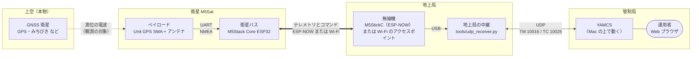
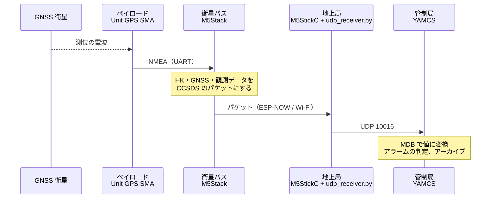
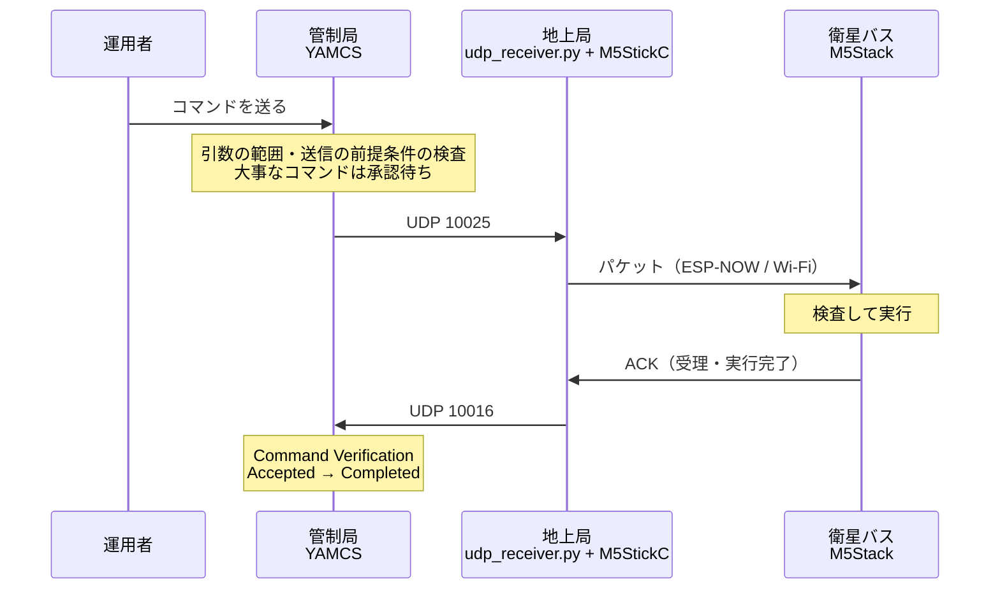
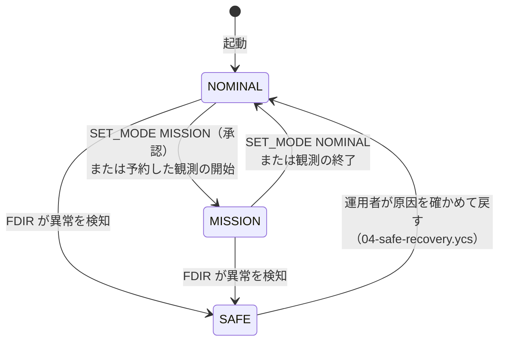

# M5Sat システムの全体像

M5Stack を人工衛星「M5Sat」に、Mac を地上の設備に見立てて、衛星の運用を模擬するシステムです。このページでは、何が何の役をしているかと、データの流れをまとめます。

- 30分のデモの進め方は [demo.md](demo.md) を見てください
- 操作の手順は [scenarios.md](scenarios.md)、本物の衛星運用との対応は [real-operations.md](real-operations.md) にあります。本物の運用の根拠になる公開資料は [real-operations.md の参考資料](real-operations.md#references) にまとめています
- パケットの形式やコマンドの一覧などの仕様は、[README](../README.md) の Milestone 5 にあります

## 1. ひと目で見る

| 役割 | 本物の衛星運用では | M5Sat では |
| --- | --- | --- |
| **衛星バス** | 衛星の本体。電源・通信・姿勢・コンピュータなど、衛星が生きていくための機能 | **M5Stack Core ESP32** のプログラム（`src/`、`lib/Satellite/`） |
| **ペイロード** | 衛星が打ち上げられた目的の機器。カメラ、観測機器、通信機器など | **Unit GPS SMA と、そのアンテナ**。GNSS 衛星の電波を受けて、信号の強さを観測する |
| **地上局** | 衛星と電波でやり取りするアンテナと無線機 | **M5StickC**（ESP-NOW の無線機）、または Wi-Fi のアクセスポイント。それと、Mac の中継プログラム `tools/udp_receiver.py` |
| **管制局** | 衛星の状態を監視し、コマンドを送り、運用を計画する所 | **Mac の上の YAMCS**（`yamcs/`）と、Web ブラウザで操作する運用者 |

## 2. 一つずつ見る

### 衛星バス：M5Stack Core ESP32

衛星本体の役です。M5Sat では、次のことをしています。

| 機能 | 中身 | 本物の衛星では |
| --- | --- | --- |
| 健康状態の報告 | HK（Housekeeping）テレメトリを1秒ごとに送る。運用モード、ペイロードの電源、コマンドの数、メモリの空き、機上時刻など | 電源・温度・姿勢などの HK |
| コマンドの実行 | 地上から届いたコマンドを検査し、実行し、結果（ACK）を返す | コマンドの受信と実行 |
| 運用モード | SAFE / NOMINAL / MISSION を切り替える | 異常時の SAFE モードなど |
| FDIR | ペイロードのデータが届かなくなったら、ペイロードを切って SAFE へ自分で逃げる | 異常の検知・切り離し・回復 |
| 機上時刻と予約 | GPS の時刻で時計を合わせ、予約した時刻に自分で観測を始める | 時刻つきのコマンド |
| イベント | モードが変わった、異常を見つけた、などを地上に知らせる | イベントの報告 |

**見える化の仕掛け（本物の衛星の機能ではない）**

机の上で、衛星の中で起きたことを目や耳で確かめるための仕掛けがあります。本物の衛星は宇宙にあって誰も見られないので、運用者が頼りにするのはテレメトリ（運用画面の HK）だけです。これらは、衛星を組み立てて試験するときに、試験設備につないで中の様子を見るのに近い位置づけです。

| 仕掛け | 何がわかるか | 本物の衛星では |
| --- | --- | --- |
| M5Stack の画面とボタン（A・B・C） | 測位の状態、見えている衛星、バスの状態 | 画面はない |
| LED（G26） | ペイロードの電源。ON で点き、OFF で消える。FDIR がペイロードを切った瞬間も見える | バスの電源系（PCDU など）がペイロードへの電源を入れ切りする。地上は HK の「ペイロード電源」で確かめる |
| `BEEP` コマンド | コマンドが衛星の中で実行されたことが音でわかる。受け取るとすぐ Accepted、鳴り終わってから Completed を返すので、受理と実行完了の時刻のずれが見える | 音を鳴らす機能はない。実行に時間がかかるコマンド（アンテナの展開、姿勢の変更など）の練習台にあたる |

### ペイロード：Unit GPS SMA と GPS アンテナ

**GPS のアンテナは、M5Sat のペイロード（観測機器）の一部です。衛星と地上局が通信するためのアンテナではありません。**

| アンテナ | 何の電波を受けるか | 役割 |
| --- | --- | --- |
| GPS アンテナ（Unit GPS SMA の SMA 端子につないだもの） | 上空の GNSS 衛星（GPS・GLONASS・Galileo・BeiDou・みちびき）の電波 | **ペイロード**。M5Sat の「観測」の入口 |
| M5Stack の中の ESP32 のアンテナ（基板に内蔵） | 地上局との ESP-NOW / Wi-Fi の電波 | **衛星バスの通信機**。テレメトリを降ろし、コマンドを受ける |
| M5StickC の中の ESP32 のアンテナ（基板に内蔵） | 衛星（M5Stack）との ESP-NOW の電波 | **地上局のアンテナ** |

上空の GNSS 衛星は、M5Sat が観測する**相手**です。M5Sat のシステムの一部ではありません。M5Sat は「GNSS 衛星の電波を観測する衛星」で、どの GNSS 衛星がどの方向（仰角・方位）に見え、どのくらいの強さで電波が届いているか（C/N0）を観測データとして地上に送ります。

GNSS の電波を観測対象にする衛星は、本物にもあります。

| 種類 | 何を測るか | 例 |
| --- | --- | --- |
| 電波掩蔽（GNSS-RO） | GNSS 衛星の電波が地球の大気をかすめて届くときの曲がり方から、気温や水蒸気を測る。天気予報に使われる | COSMIC-2、Spire の小型衛星 |
| 反射（GNSS-R） | 海面で反射した GNSS の電波から、海上の風を測る | CYGNSS |
| 電離圏の観測 | 電波の遅れから、上空の電離圏の状態を測る | |

M5Sat が測っているのは、机の上から見た「空の見え方」ですが、GNSS の電波を受けて観測データにし、地上に降ろすという流れは同じです。

GPS の受信機は、もう1つの仕事もしています。

- **ペイロードとしての仕事**：観測データ（見えている衛星ごとの信号の強さ）を作る。MISSION モードのときに地上へ送る
- **衛星バスを助ける仕事**：位置と時刻を知らせる。M5Sat は GPS の時刻で機上時刻を合わせる

本物の衛星では、GPS の受信機はふつう衛星バス側の機器（位置と時刻を知るためのセンサ）です。M5Sat では「ペイロードを ON/OFF する」「ペイロードが故障したら FDIR が切り離す」という練習をするために、ペイロードの役をさせています。そのため、ペイロードを OFF にしても、機上時刻は衛星の中の時計で数え続けます。

### 地上局：M5StickC と中継プログラム

衛星と電波でやり取りする所です。M5Sat には、2つの回線があります（M5Stack の C ボタンを2秒押して切り替える）。

| 回線 | 地上局のアンテナと無線機 | 使う場面 |
| --- | --- | --- |
| ESP-NOW | M5StickC。Mac に USB でつなぐ。衛星との通信の様子（AOS / LOS）を画面に出す | アクセスポイントが使えない場所。本物の地上局に近い形 |
| Wi-Fi（UDP） | Wi-Fi のアクセスポイント | 自宅などの、衛星と Mac が同じネットワークにいる場所 |

Mac の `tools/udp_receiver.py` は、地上局の中で、電波と管制局の間をつなぐ役です。テレメトリを YAMCS へ中継し、YAMCS から届いたコマンドを衛星へ送ります。受け取ったパケットをログ（`logs/udp_receiver.log`）にも残します。

### 管制局：YAMCS

衛星を運用する所です。YAMCS は、本物の衛星の運用にも使われているオープンソースの管制ソフトです。

| YAMCS の機能 | 運用での役割 | 設定・ファイル |
| --- | --- | --- |
| Mission Database（MDB） | パケットとコマンドの定義。バイト列を「運用モード」「ペイロードの電源」などの値に変える | `yamcs/src/main/yamcs/mdb/m5sat.xml` |
| Telemetry（Parameters / Displays） | 衛星の状態を見る。運用画面（`m5sat-overview.opi`） | `yamcs/src/main/yamcs/displays/` |
| Alarms / Events | 異常に気づく | MDB の DefaultAlarm、イベントのアルゴリズム |
| Commanding | コマンドを送り、届いて実行されたかを確かめる（Command Verification） | MDB の MetaCommand |
| Queues | 大事なコマンドは、もう一人が承認するまで送らない（二人確認） | `etc/command-queue.yaml` |
| Procedures（Stacks） | 運用手順書。1行ずつ確かめながらコマンドを送る | `yamcs/src/main/yamcs/stacks/` |
| Timeline | パスと観測の計画。予定の時刻に手順を自動で始める | `tools/plan_passes.py` |
| Archive | 届いたものを全部残し、あとから振り返る | `yamcs/target/yamcs/yamcs-data/` |

YAMCS と中継プログラムは `scripts/start.sh` でまとめて起動し、`scripts/stop.sh` で止めます。

## 3. データの流れ

### テレメトリ（衛星 → 地上）

### コマンド（地上 → 衛星）

### パケットの種類

衛星と地上は、宇宙機で広く使われている CCSDS の Space Packet でやり取りします。種類は APID という番号で見分けます。

| APID | 向き | 中身 | いつ送るか |
| --- | --- | --- | --- |
| 100 | 衛星 → 地上 | GNSS（位置・時刻・測位の状態）。ペイロードが動いているかを示す健康状態で、FDIR もこれを見ている | ペイロードが ON のとき、モードに関係なく1秒ごと |
| 101 | 衛星 → 地上 | HK（衛星の健康状態） | いつも、1秒ごと |
| 102 | 衛星 → 地上 | ACK（コマンドへの応答） | コマンドを受けたとき |
| 103 | 衛星 → 地上 | イベント（起きた出来事） | 何か起きたとき |
| 104 | 衛星 → 地上 | 観測データ（衛星ごとの信号の強さ）。ミッションの成果物 | MISSION モードのとき、1秒ごと |
| 110 | 地上 → 衛星 | コマンド | 運用者が送ったとき |
| 111 | 地上 → 衛星 | 訓練用の異常（YAMCS を通らない） | 訓練の出題者が `tools/inject_fault.py` で送ったとき |

## 4. 運用モード

| モード | 衛星の状態 |
| --- | --- |
| NOMINAL | ふだんの状態。HK と GNSS を送る |
| MISSION | 観測中。観測データも送る |
| SAFE | 異常から逃げている状態。ペイロードは OFF。ペイロードのコマンドは受け付けない。戻すのは運用者の判断 |

## 5. 模擬しているもの・していないもの

| 本物の衛星運用 | M5Sat では |
| --- | --- |
| 衛星が地上局から見える時間（パス）は1回十数分 | 模擬している。Timeline で人工のパスを作り、パスの外ではデータリンクを止める（`tools/plan_passes.py`） |
| 異常を自分で検知して SAFE へ逃げる（FDIR） | 模擬している。GPS のケーブルを抜くと起きる |
| 大事なコマンドの二人確認 | 模擬している（Queues） |
| 運用手順書 | 模擬している（Procedures の Stacks） |
| 運用の訓練（シミュレータに異常を入れる） | 模擬している。出題者が `tools/inject_fault.py` で、運用者に見えない経路から異常を起こす。本物と違い、衛星（M5Stack）がシミュレータの役も兼ねる |
| 軌道・姿勢・電力・温度 | 模擬していない。M5Sat は机の上にある |
| 電波の距離・遅延・雑音 | 模擬していない。M5Stack を持って離れると、本当に電波が弱くなって途切れる（ESP-NOW） |
| パスの外のデータを衛星に記録して、あとで降ろす（ダンプ） | まだ。[issue #34](https://github.com/vestige/m5stack-yamcs/issues/34) |
| 複数の地上局・予備の地上局 | まだ。[issue #19](https://github.com/vestige/m5stack-yamcs/issues/19) |

## 6. ファイルの地図

| 役割 | ファイル |
| --- | --- |
| 衛星バスのプログラム（M5Stack） | `src/main.cpp`、`src/*.cpp`、`lib/Satellite/`（モード・コマンド・FDIR・観測。Arduino に依存しない） |
| パケットの形 | `lib/TelemetryPacket/`、`lib/SerialFrame/` |
| ペイロードのデータの読み取り | `lib/NmeaParser/`、`src/GnssReceiver.cpp` |
| 地上局の無線機（M5StickC） | `src/ground/main.cpp` |
| 地上局の中継（Mac） | `tools/udp_receiver.py` |
| 管制局（YAMCS）の設定 | `yamcs/src/main/yamcs/etc/` |
| パケットとコマンドの定義（MDB） | `yamcs/src/main/yamcs/mdb/m5sat.xml` |
| 運用画面・手順書 | `yamcs/src/main/yamcs/displays/`、`yamcs/src/main/yamcs/stacks/` |
| 運用の道具 | `tools/send_command.py`（コマンド）、`tools/plan_passes.py`（パスの計画） |
| 訓練の道具 | `tools/inject_fault.py`（出題）、`tools/training_report.py`（振り返り）、`lib/Satellite/src/TrainingFault.h`（衛星側） |
| 起動・停止 | `scripts/start.sh`、`scripts/stop.sh`、`scripts/status.sh` |
| テスト | `test/`（PlatformIO の `native` 環境で、Mac の上で動く） |

## 7. 用語

| 用語 | 意味 |
| --- | --- |
| テレメトリ（TM） | 衛星から地上へ送るデータ |
| コマンド（テレコマンド、TC） | 地上から衛星へ送る指示 |
| HK（Housekeeping） | 衛星の健康状態を表すテレメトリ |
| APID | パケットの種類を表す番号 |
| CCSDS | 宇宙データシステム諮問委員会。宇宙機の通信の標準を決めている |
| MDB（Mission Database） | パケットとコマンドの定義。YAMCS は XTCE という形式で書く |
| FDIR | Fault Detection, Isolation and Recovery。異常の検知・切り離し・回復 |
| パス | 衛星が地上局から見えて、通信できる時間 |
| AOS / LOS | Acquisition of Signal（通信が始まる）/ Loss of Signal（通信が終わる） |
| Command Verification | コマンドが衛星に受理され、実行されたことを、ACK で確かめること |
| 機上時刻 | 衛星の中の時計 |
| GNSS | 測位衛星の総称。GPS（米国）、GLONASS（ロシア）、Galileo（欧州）、BeiDou（中国）、みちびき（日本） |
| C/N0 | 受けた電波の強さ（信号と雑音の比）。dB-Hz で表す |
