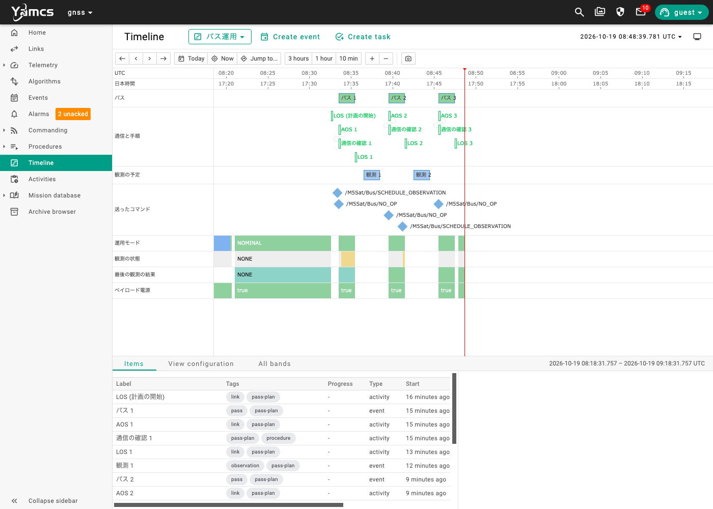

# M5Sat 運用シナリオ集

衛星 M5Sat（M5Stack）を、地上局（Mac の YAMCS）から運用するときの手順をまとめます。Milestone 5 の各ステップで実際に試したシナリオを、あとからやり直せる形にしています。

- システムの全体像（どれが衛星バス・ペイロード・地上局・管制局か）は [overview.md](overview.md) にまとめています
- 各ステップの仕様（パケットの形式やコマンドの一覧）は [README](../README.md) の Milestone 5 を見てください
- 「本物の衛星ではどうしているか」は [real-operations.md](real-operations.md) にまとめています
- YAMCS の各メニューの役割は [yamcs-web-ui.md](yamcs-web-ui.md) にまとめています

時刻について：YAMCS の Web UI や受信ログの時刻は **UTC** です。日本時間から9時間引いた時刻になります。

## 目次

| シナリオ | 内容 | 状態 |
| --- | --- | --- |
| [準備](#prepare) | 地上局を起動し、衛星とつながっていることを確かめる | |
| [回線の切り替え](#link) | Wi-Fi（UDP）と ESP-NOW を切り替える。離れて電波の強さを見る | ✅ |
| [5-1 衛星の健康状態を見る](#s5-1) | HK テレメトリの確認 | ✅ |
| [5-2 コマンドを送る](#s5-2) | Command Verification、BEEP、ペイロード電源と LED | ✅ |
| [5-3 イベントを追う](#s5-3) | 衛星からのイベント通知 | ✅ |
| [5-4 異常からの自動退避と復旧](#s5-4) | FDIR、アラームの確認、復旧の手順 | ✅ |
| [5-5 コマンドの安全装置](#s5-5) | 範囲の検査、送信の前提条件、承認フロー | ✅ |
| [5-6 時刻指定の観測](#s5-6) | 観測の予約・取り消し・中断 | ✅ |
| [5-7 手順書（コマンドスタック）で運用する](#s5-7) | 通信の確認、観測開始・終了、SAFEからの復旧 | ✅ |
| [5-8 運用画面で衛星を見守る](#s5-8) | 1画面で状態を把握し、画面のボタンで操作する。通信が途切れたことに気づく | ✅ |
| [5-9 パスに合わせて運用する](#s5-9) | Timeline でパスと観測を計画し、限られた通信の時間で運用する | ✅ |
| [5-10](#planned) | 異常対応の訓練 | 予定 |

---

<a id="prepare"></a>

## 準備

| 手順 | 操作 | 期待する結果 |
| --- | --- | --- |
| 1 | `scripts/start.sh` で YAMCS と受信スクリプトを起動する | `yamcs: ... ready` と出る |
| 2 | ESP-NOW を使うときは、地上局の無線機（M5StickC）を Mac に USB でつなぐ | M5StickC の画面が緑の `AOS` になる |
| 3 | http://localhost:8090 を開き、インスタンス `gnss` を選ぶ | |
| 4 | **Links** を開く | `m5stack-gnss` の受信数が1秒ごとに増えている |
| 5 | **Events** を開き、▶（Start streaming）でライブ表示にする | 衛星を再起動すると `BOOT` が届く |

コマンドは Web UI の **Commanding → Send a command** から送ります。ターミナルからは次のように送れます。

```sh
python3 tools/send_command.py NO_OP
python3 tools/send_command.py BEEP Duration=300
python3 tools/send_command.py SET_MODE Mode=NOMINAL --approve   # 試験用: 承認待ちの待ち行列で自動で承認する
```

`scripts/status.sh` で、地上局が動いているかと YAMCS の受信数を確かめられます。終わるときは `scripts/stop.sh` です。

---

<a id="link"></a>

## 回線の切り替え

**目的**：場所の Wi-Fi 事情に合わせて回線を選ぶ。回線を切り替えると、地上が衛星と話せなくなることがあると体験する。

| 手順 | 操作 | 見るところ | 期待する結果 |
| --- | --- | --- | --- |
| 1 | M5Stack の右ボタン（C）を**2秒長押し**する | M5Stack の画面 | 「Switching link to ...」と出て再起動する |
| 2 | | Events | `BOOT`（理由: SOFTWARE）が届く（切り替え先の回線で地上とつながっていれば） |
| 3 | | M5Stack の INFO 画面の一番下の行 | 今の回線（`UDP ...` または `ESP-NOW ch1 ...`）が出る |

- Wi-Fi のアクセスポイントがつないだ機器どうしの通信を禁止している場所（クライアント分離）では、Wi-Fi に切り替えると地上に届かなくなる。M5StickC の画面は赤の `LOS` になる。もう一度長押しして ESP-NOW に戻す
- M5StickC の USB を抜き差ししても、受信スクリプトが自動でつなぎ直す

**離れて電波の強さを見る（Wi-Fi のとき）**

| 手順 | 操作 | 見るところ | 期待する結果 |
| --- | --- | --- | --- |
| 1 | `/M5Sat/Bus/WifiRssi` を開き、Chart にする | Telemetry → Parameters | 近くでは -40〜-50 dBm |
| 2 | M5Stack を持って別の部屋へ移動し、戻ってくる | 同じグラフ | 離れると下がり（-70 dBm 前後）、戻ると元に戻る |

金属の鍋や缶に入れてふたをすると、その場で大きく下がり、通信が途切れる。

---

<a id="s5-1"></a>

## 5-1 衛星の健康状態を見る

**目的**：HK（Housekeeping）テレメトリで、衛星の健康状態を確かめる。

| 手順 | 操作 | 見るところ | 期待する結果 |
| --- | --- | --- | --- |
| 1 | | Telemetry → Parameters の `/M5Sat/Bus/` | モード・ペイロード電源・コマンドカウンタ・空きメモリ・起動からの時間が1秒ごとに更新される |
| 2 | M5Stack のリセットボタンを押す | `/M5Sat/Bus/BootCount`、`ResetReason` | 再起動の回数が1つ増える。理由は `POWER_ON`（ESP32 の仕様で、リセットボタンもこうなる） |
| 3 | Wi-Fi のとき、アクセスポイントから離れる | `/M5Sat/Bus/WifiRssi` | RSSI が下がる（[回線の切り替え](#link) を参照） |

---

<a id="s5-2"></a>

## 5-2 コマンドを送る

**目的**：コマンドを送り、衛星が受理・実行したことを Command Verification で見届ける。

| 手順 | 操作 | 見るところ | 期待する結果 |
| --- | --- | --- | --- |
| 1 | `NO_OP` を送る | Commanding → Command history | Accepted → Complete と進む |
| 2 | `BEEP` を `Duration=300` で送る | M5Stack、Command history | M5Stack が「ピッ」と鳴る。鳴り終わってから Complete になる |
| 3 | `SET_TM_INTERVAL` を `Interval=2000` で送る | 受信ログ（`tail -f logs/udp_receiver.log`） | HK の届く間隔が2秒になる |
| 4 | `SET_TM_INTERVAL` を `Interval=1000` で送る | | 1秒に戻る |
| 5 | `PAYLOAD_POWER` を `State=OFF` で送る | M5Stack の LED と画面、受信ログ | LED が消え、画面のバッジが `PAYLOAD OFF` になる。GNSS テレメトリ（APID 100）が届かなくなる |
| 6 | `PAYLOAD_POWER` を `State=ON` で送る | | LED が点き、GNSS テレメトリが戻る |

- 範囲外の値（例：`Interval=50`）は、5-5 からは YAMCS が送る前に止める。衛星側でも同じ範囲で検査していて、衛星に届けば `INVALID_ARGUMENT` で拒否される
- 拒否されたコマンドの理由は `/M5Sat/Bus/AckErrorCode` と Events で見られる

---

<a id="s5-3"></a>

## 5-3 イベントを追う

**目的**：衛星から届くイベントで、何が起きたかを時系列で追う。

**準備**：Events をライブ表示にしたまま、別のタブで Commanding → Send a command を開く。

| 手順 | 操作 | Events に届くイベント |
| --- | --- | --- |
| 1 | M5Stack のリセットボタンを押す | INFO「起動しました (○回目, 理由: POWER_ON)」 |
| 2 | `SET_MODE` を `Mode=SAFE` で送る（Queues で承認する） | INFO「運用モードを NOMINAL から SAFE に変更しました」と「ペイロードの電源を OFF にしました」の2つ |
| 3 | `SET_MODE` を `Mode=NOMINAL` で送る（Queues で承認する） | INFO「運用モードを SAFE から NOMINAL に変更しました」 |
| 4 | `PAYLOAD_POWER` を `State=ON` で送る | INFO「ペイロードの電源を ON にしました」 |

---

<a id="s5-4"></a>

## 5-4 異常からの自動退避と復旧

**目的**：衛星が異常を自分で検知して SAFE へ退避し、地上が気づいて復旧させる、という一連の流れを体験する。

**準備**：Events（ライブ表示）と Alarms を開いておく。モードは NOMINAL、ペイロードは ON。

| 手順 | 操作 | 見るところ | 期待する結果 |
| --- | --- | --- | --- |
| 1 | GPS ユニットの Grove ケーブルを抜く | M5Stack、Events、Alarms | 10秒後に DISTRESS「異常を検知しました: GNSSのデータが届きません」→ ペイロード OFF（LED が消える）→ SAFE。Alarms に `Mode` の Warning が上がる |
| 2 | Alarms でアラームを確認する（Acknowledge を押す） | Alarms | 未確認（unacked）の数が減る |
| 3 | ケーブルを戻す | | |
| 4 | **復旧の手順**を行う（下を参照）。手順書（スタック）`04-safe-recovery.ycs` を使ってもよい（[5-7](#s5-7)） | | NOMINAL に戻り、GNSS のデータが届く。アラームは消える |

**復旧の手順**（5-5 の安全装置で、SAFE のままではペイロードを入れられない）

1. Events の `FAULT_DETECTED` で、何が起きたかを確かめる
2. 原因を直す（今回は GPS ユニットのケーブルを戻す）
3. `SET_MODE` を `Mode=NOMINAL` で送り、Commanding → Queues で承認する。`/M5Sat/Bus/Mode` が NOMINAL になったことを確かめる
4. `PAYLOAD_POWER` を `State=ON` で送り、`/M5Sat/GNSS/...` のデータが届き始めたことを確かめる

YAMCS は届いている最新のテレメトリで送信の前提条件を判断する。手順3の結果が HK に出る（最大1秒）のを待ってから手順4を送る。

**あわせて試すこと**

| 試すこと | 期待する結果 |
| --- | --- |
| ケーブルを抜いたまま復旧の手順を行う | ペイロードを入れてから30秒（最初のデータを待つ猶予）で、また SAFE へ退避する |
| `SET_FDIR` を `State=OFF` にしてから（Queues で承認）ケーブルを抜く | 退避しない。画面は `NO DATA` になる |
| 終わったら `SET_FDIR` を `State=ON` に戻す | `FDIR_CHANGED`（有効）が届く。ケーブルが抜けたままなら、また退避する |

**アラームの操作**

| 操作 | 意味 |
| --- | --- |
| Acknowledge | 「見ました、対応します」。正常に戻っていれば一覧から消える |
| Shelve | 「わかっているので、しばらく通知しないで」。期限まで一覧から隠れる |
| Unshelve | Shelve を取り消し、また通知されるようにする |

---

<a id="s5-5"></a>

## 5-5 コマンドの安全装置

**目的**：危ないコマンドが、地上で止められることを確かめる。

| 手順 | 操作 | 見るところ | 期待する結果 |
| --- | --- | --- | --- |
| 1 | `SET_TM_INTERVAL` を `Interval=50` で送ろうとする | Send a command の画面 | 範囲外（200〜10000）として、送る前に止められる |
| 2 | `SET_MODE` を `Mode=SAFE` で送る | Commanding → Queues | `supervised` の待ち行列に入る（待ち行列の表示は `HOLD`） |
| 3 | 待ち行列の中のコマンドを承認（Accept）する | M5Stack、Events | 衛星へ送られ、SAFE になる |
| 4 | SAFE のまま `PAYLOAD_POWER` を `State=ON` で送る | Command history | TransmissionConstraints が NOK（「Transmission constraints check failed」）。衛星には送られない |
| 5 | ペイロードが OFF のまま `SET_MODE` を `Mode=MISSION` で送り、承認する | Command history | 同じく、送信の前提条件で止められる |
| 6 | [5-4 の復旧の手順](#s5-4) で NOMINAL・ペイロード ON に戻す | | |

待ち行列そのものを `ACCEPT` に切り替えると、それ以降の critical のコマンドが承認なしで送られるようになる。待ち行列の状態は変えず、中のコマンドを1つずつ承認する。

---

<a id="s5-6"></a>

## 5-6 時刻指定の観測

**目的**：観測を予約し、衛星が予約した時刻に自分で観測を始めて終えることを確かめる。

**準備**：Events をライブ表示にしておく。モードは NOMINAL、ペイロードは ON。`/M5Sat/Bus/OnboardTime`（機上時刻）が今の UTC になっていることを確かめる（まだ GPS の時刻を受け取っていないと、予約は拒否される）。

| 手順 | 操作 | 見るところ | 期待する結果 |
| --- | --- | --- | --- |
| 1 | `SCHEDULE_OBSERVATION` を、`Start` に5分後の UTC 時刻、`Duration=180` で送り、Queues で承認する | Events、`/M5Sat/Bus/ObservationState` | INFO「観測を予約しました (○秒後から 180秒間)」。状態が `SCHEDULED` になる |
| 2 | 予約した時刻まで待つ | M5Stack のヘッダ、Events | 水色の `MISSION` になる。「観測を始めました」 |
| 3 | 観測中のデータを見る | `/M5Sat/GNSS/AverageCn0`、`TrackedCount` などを Chart に。`ObservedSatellites` を開く | まとめの値が1秒ごとに更新される。衛星ごとの一覧（最大32機）が見られる |
| 4 | 3分待つ | M5Stack、Events | NOMINAL に戻り、「観測を終えました」 |

**あわせて試すこと**

| 試すこと | 期待する結果 |
| --- | --- |
| 予約してから `CANCEL_OBSERVATION` を送る（Queues で承認） | 「観測の予約を取り消しました」。予約した時刻を過ぎても観測は始まらない |
| 観測が始まったら `PAYLOAD_POWER` を `State=OFF` で送る | NOMINAL に戻り、WARNING「観測を中断しました」 |
| 予約したあと、開始時刻の前にペイロードを OFF にする | 開始時刻に WARNING「予約した観測を見送りました: ペイロードの電源がOFFです」 |

---

<a id="s5-7"></a>

## 5-7 手順書（コマンドスタック）で運用する

**目的**：決まった作業を、手順書（スタック）に沿って1行ずつ確かめながら進める。

**準備**：**Procedures → Stacks** を開く。4つのスタックが並んでいる。承認のために、別のタブで **Commanding → Queues** も開いておく。

| スタック | 使う場面 |
| --- | --- |
| `01-link-check.ycs` | パスの始めに、テレメトリとコマンドがやり取りできることを確かめる |
| `02-observation-start.ycs` | 観測を手で始める |
| `03-observation-end.ycs` | 観測を手で終える |
| `04-safe-recovery.ycs` | FDIR などで SAFE へ退避したあと、元に戻す |

**スタックの進め方**

| ステップ | 何が起きるか | 運用者がすること |
| --- | --- | --- |
| `text` | 説明が表示される | 読む |
| `check` | パラメータの今の値が表示される | 目で確かめて、次へ進める |
| `command` | コマンドが送られる。Command Verification が完了するまで次へ進まない | critical のコマンド（`SET_MODE`）は、Queues で承認する |
| `verify` | テレメトリが条件を満たすまで待つ | 待つ。時間切れで止まったら、原因を調べる |

実行のしかたは、1ステップずつ進める方法と、続けて実行する方法がある。初めは1ステップずつ進め、慣れたら続けて実行する（承認待ちと時間切れのところだけで止まる）。

| 手順 | 操作 | 期待する結果 |
| --- | --- | --- |
| 1 | `01-link-check.ycs` を実行する | `NO_OP` が完了し、受理したコマンド数が増える |
| 2 | `02-observation-start.ycs` を実行する。`SET_MODE` で止まったら Queues で承認する | MISSION になり、観測データが届き始める |
| 3 | `03-observation-end.ycs` を実行する（同じく承認する） | NOMINAL に戻り、ペイロードが OFF になる |
| 4 | GPS ユニットのケーブルを抜き、FDIR で SAFE へ退避させる（[5-4](#s5-4)） | SAFE になり、アラームが上がる |
| 5 | アラームを確認し、ケーブルを戻してから `04-safe-recovery.ycs` を実行する | NOMINAL に戻り、GNSS のデータが届く。35秒後も NOMINAL のまま |

**あわせて試すこと**

| 試すこと | 期待する結果 |
| --- | --- |
| ケーブルを抜いたまま `04-safe-recovery.ycs` を実行する | 「GNSSのデータが届き始めた」の `verify` が時間切れになり、スタックが止まる |
| `02-observation-start.ycs` の `SET_MODE` を、Queues で承認せずに放っておく | 承認するまで、スタックは先へ進まない |

---

<a id="s5-8"></a>

## 5-8 運用画面で衛星を見守る

**目的**：他のメニューを行き来せず、1枚の画面だけで衛星の状態をつかみ、次のコマンドを判断する。

**準備**：**Telemetry → Displays** を開く。2つの画面が並んでいる。承認のために、別のタブで **Commanding → Queues** も開いておく。

| 画面 | 中身 |
| --- | --- |
| `m5sat-overview.opi` | 運用画面。モード、ペイロード、FDIR、コマンドの結果、観測、GNSS を区画ごとにまとめ、コマンドのボタンを置いたもの |
| `m5sat-hk.par` | HK のパラメータを表に並べたもの。受信した時刻と取得状態（`ACQUIRED` / `EXPIRED`）も見える |

**運用画面の見かた**

| 見た目 | 意味 |
| --- | --- |
| 運用モードの背景が緑 / 青 / 黄 | NOMINAL / MISSION / SAFE |
| ペイロード電源・FDIR のランプが緑 | ON |
| 値の枠がオレンジ・赤 | アラーム（SAFE、測位できていない など） |
| 値が紫になる（運用モードは周りの太い枠が紫になる） | テレメトリが途切れた（期限切れ）。最後に届いてから約19秒で変わる。コマンドを送ったときだけ届く ACK の3行は、紫にならない |
| 値をクリックする | そのパラメータの詳細（グラフや履歴）へ移る |

| 手順 | 操作 | 期待する結果 |
| --- | --- | --- |
| 1 | `m5sat-overview.opi` を開く | 値が1秒ごとに更新される。運用モードが NOMINAL（緑） |
| 2 | **NO_OP** ボタンを押し、確認ダイアログで OK を押す | 受理した数が1増え、最後のACKが `NO_OP` / `COMPLETED` になる |
| 3 | **PAYLOAD ON** を押す | ペイロード電源が ON（緑）になり、GNSS の区画の値が更新され始める |
| 4 | **MODE MISSION** を押す | 待ち行列に入るので、Queues で承認する。運用モードが MISSION（青）になり、観測の区画の値が更新され始める |
| 5 | **MODE NOMINAL** を押し、Queues で承認する | NOMINAL（緑）に戻る。観測の区画の値は約19秒後に紫（期限切れ）になる |
| 6 | **PAYLOAD OFF** を押す | ペイロード電源が OFF になる。GNSS の区画の値は約19秒後に期限切れになる |
| 7 | 衛星の電源を切る（または離れて通信を途切れさせる） | 約19秒で、すべての値が期限切れになる。戻すと元の表示に戻る |

手順の 2〜6 は、5-7 の `01-link-check.ycs`・`02-observation-start.ycs`・`03-observation-end.ycs` と同じ流れ。スタックで進めながら、運用画面で結果を確かめてもよい。

**あわせて試すこと**

| 試すこと | 期待する結果 |
| --- | --- |
| SAFE のまま **PAYLOAD ON** を押す | 送信の前提条件（5-5）で止められ、送られない |
| `m5sat-hk.par` で **ADD** からパラメータを足し、**SAVE** する | 表に列が増える。`yamcs/src/main/yamcs/displays/m5sat-hk.par` のファイルも書き換わる |
| `m5sat-hk.par` で **SCROLL VIEW** にする | 値が届くたびに1行ずつ下へ積み重なる（履歴の表示） |

---

<a id="s5-9"></a>

## 5-9 パスに合わせて運用する

**目的**：衛星と通信できる時間（パス）が限られている中で、パスの間に状態を確かめ、次のパスまでの間に衛星が自分で行う観測を予約する。通信できない間に起きたことを、次のパスで確かめる。

**準備**

| 手順 | 操作 | 期待する結果 |
| --- | --- | --- |
| 1 | 衛星にファームウェアを書き込んである（HK が53バイトの版） | |
| 2 | 運用モードが NOMINAL、ペイロードが ON であることを確かめる | |
| 3 | `python3 tools/plan_passes.py create` を実行する | パスの時刻と、各パスの間に予約する観測の引数が表示される |
| 4 | **Timeline** を開き、上のビューの選択で「パス運用」を選ぶ | パス・通信と手順・観測の予定の帯に、予定が並ぶ |
| 5 | 別のタブで運用画面（`m5sat-overview.opi`）と **Commanding → Queues** を開いておく | |

既定では、1分後から10分ごとに2分間のパスが3回あり、各パスの2分後から4分間の観測を予定する。約30分かかる。短く試すときは `--interval 6` などにする。

**パスの流れ**

| 手順 | 時刻 | 操作 | 期待する結果 |
| --- | --- | --- | --- |
| 1 | 計画の開始 | 待つ | 「LOS（計画の開始）」でデータリンクが止まる。約19秒で運用画面の値が紫（期限切れ）になる |
| 2 | パス1の AOS | 待つ | データリンクが有効になり、運用画面の色が戻る。続けて「通信の確認 1」が自動で走り、`NO_OP` が完了する（**Activities** で確かめられる） |
| 3 | パス1の間 | 観測の予定「観測 1」の引数で `SCHEDULE_OBSERVATION` を送り、Queues で承認する | 観測の状態が SCHEDULED になる |
| 4 | パス1の LOS | 待つ | データリンクが止まる。この後、通信できない間に衛星が自分で観測する（M5Stack の画面で MISSION になるのが見える） |
| 5 | パス2の AOS | 運用画面の「最後の観測」を見る | 結果が COMPLETED、始めた時刻が予定どおり、観測した長さが予約した長さ、完了数が1増えている |
| 6 | パス2の間 | 「観測 2」を予約する | |
| 7 | パス3の AOS | 「最後の観測」を見る | 観測 2 の結果が出ている |
| 8 | 終わったら | `python3 tools/plan_passes.py clear` | データリンクが有効に戻り、常時通信になる。終わった予定は Timeline に残る（全部消すときは `clear --all`） |

観測を予約するコマンドは、Web UI の **Send a command** で送るか、ターミナルから送る（`create` が表示した引数をそのまま使える）。

```sh
python3 tools/send_command.py SCHEDULE_OBSERVATION Start=2026-10-19T06:30:49.000Z Duration=240 --approve
```

**振り返り**：Timeline のビュー「パス運用」で、時間軸を広げて（「1 hour」など）次を照らし合わせる。

- 観測の予定と、最後の観測の結果の帯（COMPLETED に変わった時刻）
- パスの外で、運用モードや観測の状態の帯が途切れていること（その間は地上に何も届いていない）
- 送ったコマンドが、どれもパスの間に入っていること

**Archive browser** でも、パケットがパスの間にだけ届いていることを確かめられる。

**実験の結果**（2026-10-19、`create --interval 6`：6分ごとに2分間のパスを3回）



| 帯 | 読み取れること |
| --- | --- |
| パス | パス1〜3が6分ごとに2分間 |
| 通信と手順 | 計画開始の LOS → 各パスの AOS → 通信の確認 → LOS が、すべて成功（緑） |
| 観測の予定 | 観測1・2が、パスとパスの間に入っている |
| 送ったコマンド | 自動の通信の確認（`NO_OP`）と、観測の予約（`SCHEDULE_OBSERVATION`）。1つ目の予約はパス1の前に待ち行列へ入れ、パス1の間に承認して送った |
| 運用モード・ペイロード電源 | パスの間だけ描かれ、パスの外は空白（地上に何も届いていない） |
| 観測の状態 | パス1・2の終わりに SCHEDULED（黄色）。予約してからパスを終えた |
| 最後の観測の結果 | パス1までは NONE。パス2・パス3の始めに COMPLETED（緑）として届いた |

観測中に衛星が MISSION になったことは地上に届いていないので、運用モードの帯には出ない。代わりに、次のパスで届いた HK の「最後の観測」で確かめた。

| 観測 | 予定の開始（UTC） | 始めた時刻 | 長さ | 結果 | 完了数 |
| --- | --- | --- | --- | --- | --- |
| 1 | 08:36:31 | 08:36:31 | 120 s | COMPLETED | 1 |
| 2 | 08:42:31 | 08:42:31 | 120 s | COMPLETED | 2 |

**あわせて試すこと**

| 試すこと | 期待する結果 |
| --- | --- |
| 観測を予約したあと、パスの間に `PAYLOAD_POWER OFF` を送る | 次のパスで、最後の観測が `SKIPPED_PAYLOAD_OFF` になり、警告のアラームが上がる |
| 衛星の電源を切ったまま AOS を迎える | AOS が15秒で失敗し、「通信の確認」は始まらない（SKIPPED） |
| パスの外で、運用画面のボタンからコマンドを送る | データリンクが止まっているので送れず、Command history に `no link available` と残る |

---

<a id="planned"></a>

## 5-10（予定）

これから作るステップのシナリオです。作りながら育てていきます。

### 5-10 異常対応の訓練

訓練の出題者は、運用者に知らせずに異常を1つ起こす。運用者はアラームやイベントから異常に気づき、Command history や HK を手がかりに原因を推定し、手順書（`04-safe-recovery.ycs`）で衛星を元に戻す。気づくまでと復旧までにかかった時間を記録する。
